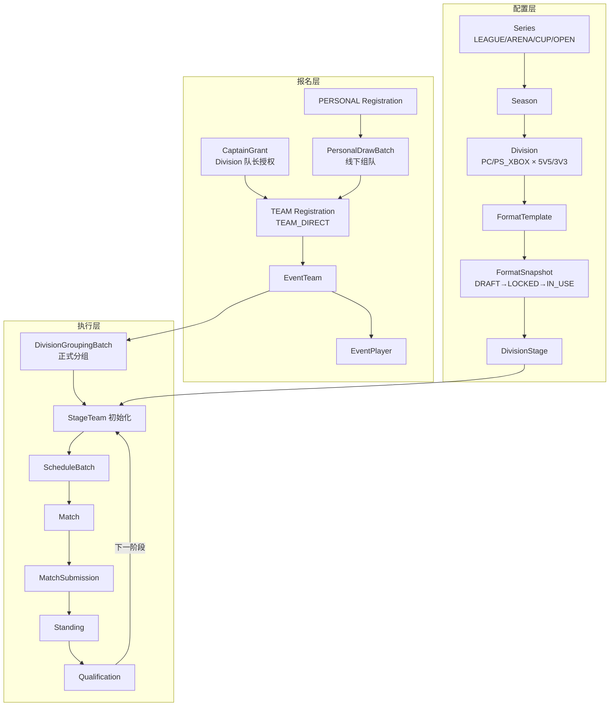
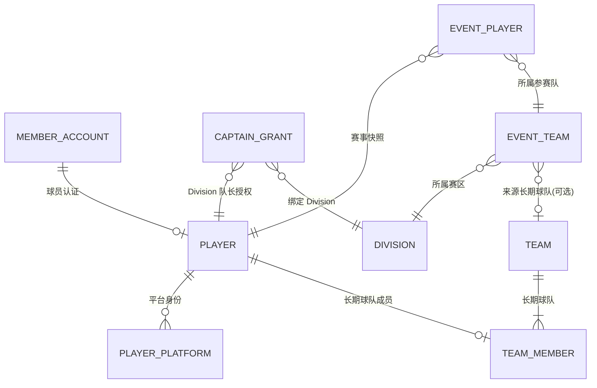
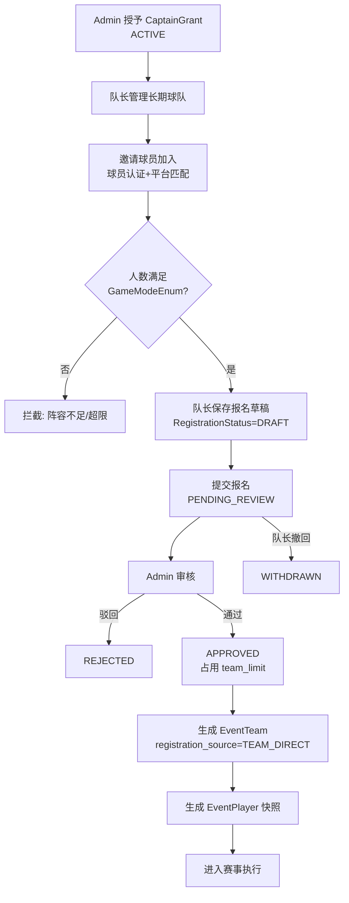
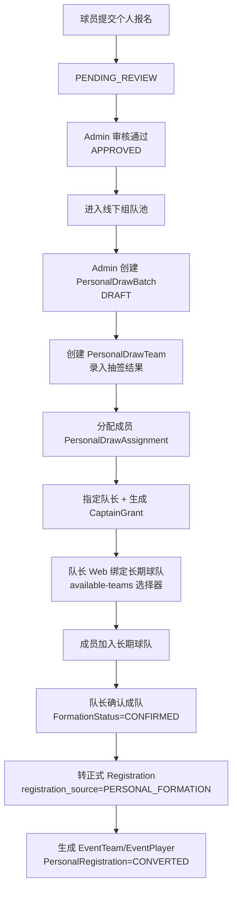
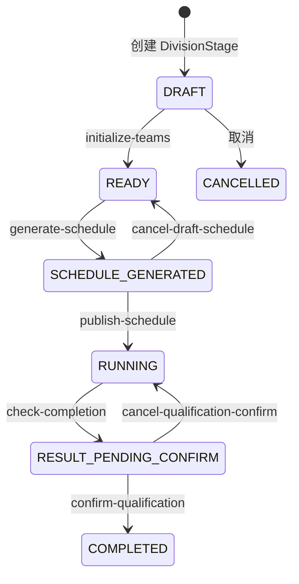
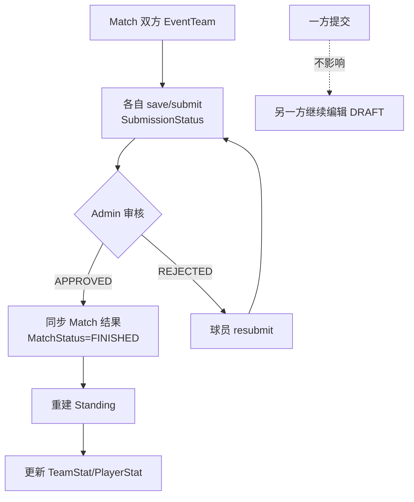
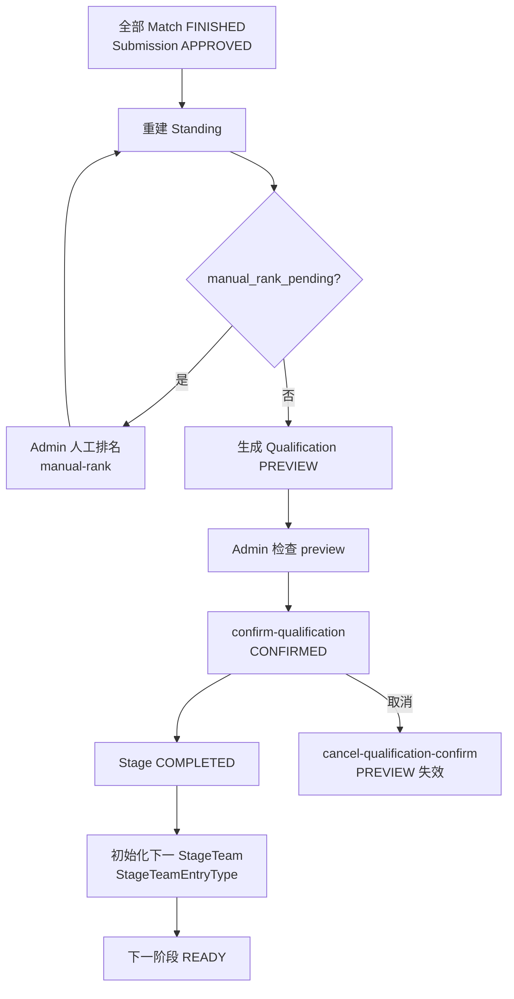
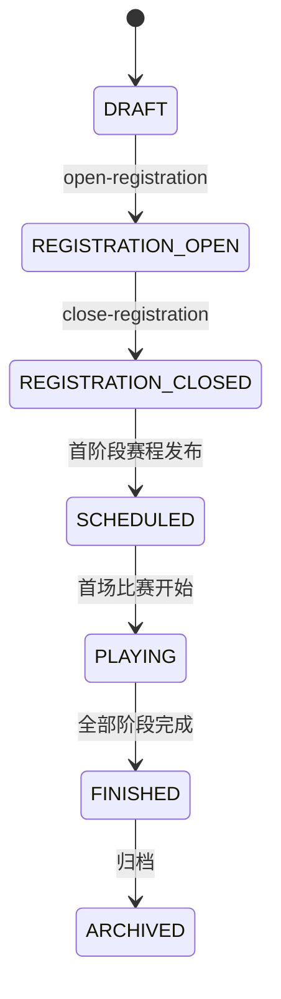

# CNPA 篮球官网 V2 最终业务实现流程

**文档版本**：V2 Final（R5 收口）
**更新时间**：2026-08-05
**适用范围**：basketball-admin / basketball-web / basketball-admin-ui / basketball-web-ui
**权威数据源**：V4 枚举（`com.zhs.basket.enums.v4` / `com.zhs.enums.v4`）、V4 Controller、最终 Schema（`docs/sql/cnpa-v2-final-schema.sql`）

> 本文档为 CNPA 篮球官网 V2 最终版本的**唯一权威业务流程说明**。所有状态枚举、API 路径、表名均来自最终代码，不含旧 Tournament 域、Legacy 赛程、过渡字段。

---

## 1. 项目定位

CNPA（China National Pro-Am）篮球官网是一套面向业余/半职业篮球赛事的数字化平台，覆盖：
- **前台 Web**：球员注册、认证、报名、赛程、比赛数据提交、公开赛事展示
- **后台 Admin**：赛事发布、报名审核、赛程生成、比赛数据审核、统计榜单、队长授权
- **内容运营**：公告、合作伙伴、名人堂（独立于赛事写链路）

V2 最终版本的核心定位：
- **单一赛事域写链路**：Series → Season → Division → … → Qualification
- **双报名方式**：TEAM（球队直接报名）与 PERSONAL（个人报名 + 线下组队）
- **双平台**：PC 与 PS_XBOX（玩家身份仍保留 PS / Xbox 细分）
- **双模式**：FIVE_V_FIVE（5V5）与 THREE_V_THREE（3V3）
- **三种赛制阶段**：ROUND_ROBIN（单循环）、GROUP_STAGE（小组赛）、SINGLE_ELIMINATION（单败 BO1）

V2 明确**不再保留**：旧 Tournament 赛事域、Legacy 赛程生成、旧报名/积分/比赛数据写入口、`basket_captain_qualification`、`rank_explain_json`。

---

## 2. 最终业务主线

最终赛事域固定为以下对象链，**唯一写链路**通过 Admin V4 Controller + Web V4 Controller / Public API 实现：
```text
Series
  └── Season
        └── Division
              ├── FormatTemplate（模板引用）
              ├── FormatSnapshot（Division 实际规则快照）
              ├── DivisionStage（阶段实例）
              ├── Registration / PersonalRegistration（报名）
              ├── EventTeam / EventPlayer（正式参赛快照）
              ├── DivisionGroupingBatch（正式分组，GROUP_STAGE 适用）
              ├── ScheduleBatch / Match（赛程与比赛）
              ├── MatchSubmission（比赛数据提交）
              ├── Standing / StandingRankReason（积分榜与排名解释）
              └── Qualification（晋级结果）
```

### 总业务流程 Mermaid



**关键原则**：
- Division 是报名与赛事执行的**最小业务单元**
- FormatSnapshot 锁定后，模板修改不影响已发布 Division
- EventTeam/EventPlayer 是赛事快照，与长期球队/永久球员严格分离
- 赛程**仅**允许通过 Stage Execution 生成，禁止 Legacy `/schedule-batch/generate`
- Standing 排名解释使用 `basket_standing_rank_reason`，禁止 `rank_explain_json`

---

## 3. 角色模型

| 序号 | 角色 | 说明 | 典型操作 |
|------|------|------|----------|
| 1 | 用户账号 | 邮箱注册，非赛事身份 | 注册、登录、设置 |
| 2 | 永久球员 | 认证后的球员身份，一账号一球员 | 报名、加入球队、提交比赛数据 |
| 3 | Division 队长 | 绑定特定 Division 的临时授权 | TEAM 报名、比赛数据提交、成队确认 |
| 4 | 长期球队负责人 | 管理长期球队 | 邀请成员、维护资料 |
| 5 | EventTeam 成员 | 某届赛事正式参赛球员 | 查看赛程、提交数据 |
| 6 | 赛事运营管理员 | Admin 赛事域操作 | 发布赛事、审核、排赛 |
| 7 | 比赛数据审核人员 | Admin 审核 Submission | 通过/驳回比赛数据 |
| 8 | 内容运营人员 | 公告/合作伙伴/名人堂 | 内容 CRUD |
| 9 | 系统管理员 | 若依系统管理 + 赛事运营授权 | 用户/权限/菜单 |

### 角色关系




---

## 4. 账号和球员认证

### 4.1 账号注册流程

```
邮箱 → 邮箱验证码 → 设置密码 → 注册成功（不自动登录）
```
相关表：`basket_member_account`

### 4.2 球员认证流程

```
用户登录 → 提交球员认证申请 → Admin 审核 → 生成永久球员 ID
```
**约束**：
- 一个账号最多一个有效永久球员身份
- 未完成球员认证：不能加入球队、不能报名赛事、不能成为 EventPlayer
相关表：`basket_player`、`basket_player_certification`（审核记录）

### 4.3 Admin 接口

| 操作 | 说明 |
|------|------|
| 球员认证审核 | Admin 账号与认证模块（非 V4 赛事 Controller） |
| 用户管理 | 若依 sys_user + basket_member_account |

---

## 5. 平台身份

永久球员可维护游戏平台身份：
| 平台 Code | 说明 | 适用 Division |
|-----------|------|---------------|
| `PC` | PC 游戏 ID | `PC` Division |
| `PS` | PS 游戏 ID（历史细分） | 可匹配 `PS_XBOX` Division |
| `XBOX` | Xbox 游戏 ID（历史细分） | 可匹配 `PS_XBOX` Division |
| `PS_XBOX` | Division 平台枚举（非玩家身份） | Division 配置用 |

**规则**：
- 新建 Division 平台只允许 `PC`、`PS_XBOX`（`PlatformCodeEnum`）
- 平台身份新增或修改需要 Admin 审核
- 同一平台游戏 ID 不能重复
- 已被赛事快照锁定的平台身份不能随意修改
相关表：`basket_player_platform`、`basket_player_platform_change_request`

---

## 6. 队长授权

CNPA **不存在**永久赛事队长资格。队长授权必须绑定 `division_id`。

### 6.1 权威表

- `basket_captain_grant`：Division 队长授权记录
- `basket_captain_grant_log`：授权操作日志

### 6.2 状态枚举 CaptainGrantStatusEnum

| Code | 描述 |
|------|------|
| `ACTIVE` | 有效 |
| `REVOKED` | 已撤销 |
| `EXPIRED` | 已过期 |

### 6.3 来源枚举 CaptainGrantSourceEnum

| Code | 描述 |
|------|------|
| `MANUAL` | 人工授予 |
| `PERSONAL_DRAW` | 个人抽签成队时自动生成 |

### 6.4 授权结束条件

- Division 结束（`FINISHED` / `ARCHIVED`）
- 管理员撤销（`PUT /basket/v4/captain-grant/{id}/revoke`）
- 超过有效期
- 授权状态变为 `REVOKED` 或 `EXPIRED`

### 6.5 Admin API

| 方法 | 路径 | 权限 |
|------|------|------|
| GET | `/basket/v4/captain-grant/list` | `basket:v4CaptainGrant:list` |
| POST | `/basket/v4/captain-grant` | `basket:v4CaptainGrant:add` |
| PUT | `/basket/v4/captain-grant/{id}/revoke` | `basket:v4CaptainGrant:revoke` |

**禁止**继续读取 `basket_captain_qualification`（R5 已迁移至 `basket_captain_grant`）。

---

## 7. 长期球队

长期球队（`basket_team`）用于保存：球队名称、Logo、历史、当前成员、球队认证、球队资料。

**关键区分**：
| 概念 | 性质 | 表 |
|------|------|-----|
| 长期球队 | 长期资产，跨赛季 | `basket_team`、`basket_team_member` |
| EventTeam | 某 Division 正式参赛快照 | `basket_event_team` |

**约束**：
- 一名球员任意时刻只能加入一支有效长期球队
- 长期球队不直接代表某届赛事参赛队伍
- EventTeam 通过 `registration_id` 和 `team_id`（可选）关联来源

---


## 8. TEAM 报名

### 8.1 完整流程

```
管理员授予 Division 队长授权
  → 队长创建或管理长期球队
  → 邀请永久球员加入球队
  → 球队成员满足 Division 阵容人数
  → 队长选择正式报名阵容
  → 提交 TEAM_DIRECT Registration
  → 后台报名审核
  → 审核通过占用正式名额
  → 生成 EventTeam + EventPlayer
  → 正式进入赛事
```

### 8.2 TEAM 报名流程 Mermaid



### 8.3 前置条件

**队长必须满足**：
- 已登录
- 已通过球员认证
- 当前 Division 有效队长授权（`CaptainGrantStatusEnum.ACTIVE`）
- 有权限管理当前长期球队

**球队必须满足**：
- 状态有效
- 未在当前 Division 重复报名
- 成员人数满足 `GameModeEnum`（5V5: 5-8 人；3V3: 3-8 人）
- 所有报名球员均为有效球队成员
- 所有报名球员均通过球员认证
- 所有报名球员平台身份匹配 Division
- 同一球员不能在同一 Division 重复报名

### 8.4 状态枚举 RegistrationStatusEnum

| Code | 描述 | 占名额 | 可撤销 | 生成 EventTeam |
|------|------|--------|--------|----------------|
| `DRAFT` | 草稿 | 否 | 是 | 否 |
| `PENDING_REVIEW` | 待审核 | 否 | 是（WITHDRAWN） | 否 |
| `APPROVED` | 已通过 | **是** | 否 | **是** |
| `REJECTED` | 已驳回 | 否 | 否 | 否 |
| `WITHDRAWN` | 已撤回 | 否 | — | 否 |
| `CANCELLED` | 已取消 | 否 | — | 否 |

### 8.5 报名来源 RegistrationSourceEnum

| Code | 描述 |
|------|------|
| `TEAM_DIRECT` | 球队直接报名 |
| `PERSONAL_FORMATION` | 个人组队转换 |

### 8.6 Web API（球员端）

| 方法 | 路径 | 说明 |
|------|------|------|
| GET | `/basket/v4/player/registration/available-divisions` | 可报名 Division 列表 |
| POST | `/basket/v4/player/registration/save` | 保存草稿 |
| POST | `/basket/v4/player/registration/submit` | 提交审核 |
| POST | `/basket/v4/player/registration/withdraw` | 撤回 |
| GET | `/basket/v4/player/registration/my-list` | 我的报名 |
| GET | `/basket/v4/player/registration/{registrationId}/detail` | 报名详情 |

### 8.7 Admin API

| 方法 | 路径 | 权限 |
|------|------|------|
| GET | `/basket/v4/registration-audit/list` | `basket:v4RegistrationAudit:list` |
| POST | `/basket/v4/registration-audit/{registrationId}/approve` | `basket:v4RegistrationAudit:approve` |
| POST | `/basket/v4/registration-audit/{registrationId}/reject` | `basket:v4RegistrationAudit:reject` |

### 8.8 并发控制

正式名额（`team_limit`）**仅在审核通过时占用**。审核中不占用。最后一个名额必须使用 Division 行锁或等价并发控制。

---

## 9. PERSONAL 报名

### 9.1 完整流程

```
永久球员 → 选择 PERSONAL Division → 提交个人报名 → 后台审核
  → 进入待线下组队池 → 运营录入线下抽签结果 → 创建临时队伍
  → 分配成员 → 指定临时队伍队长 → 生成 Division 队长授权
  → 队长创建或选择长期球队 → 邀请分配成员加入 → 确认成队
  → 生成 PERSONAL_FORMATION Registration → 审核/确认
  → 生成 EventTeam / EventPlayer → 正式进入赛事
```

### 9.2 PERSONAL 报名流程 Mermaid



### 9.3 状态枚举 PersonalRegistrationStatusEnum

| Code | 描述 |
|------|------|
| `DRAFT` | 草稿 |
| `PENDING_REVIEW` | 待审核 |
| `APPROVED` | 已通过（进入组队池） |
| `REJECTED` | 已驳回 |
| `WITHDRAWN` | 已撤回 |
| `ASSIGNED` | 已分配（已分配到 DrawTeam） |
| `CONVERTED` | 已转换（已生成 EventTeam） |

### 9.4 Web API

| 方法 | 路径 | 说明 |
|------|------|------|
| GET | `/basket/v4/player/personal-registration/available-divisions` | 可报名 Division |
| POST | `/basket/v4/player/personal-registration/save` | 保存 |
| POST | `/basket/v4/player/personal-registration/submit` | 提交 |
| POST | `/basket/v4/player/personal-registration/withdraw` | 撤回 |
| GET | `/basket/v4/player/personal-registration/my-list` | 我的个人报名 |

### 9.5 Admin API

| 方法 | 路径 | 权限 |
|------|------|------|
| GET | `/basket/v4/admin/personal-registrations/list` | `basket:v4PersonalReg:list` |
| POST | `/basket/v4/admin/personal-registrations/{id}/approve` | `basket:v4PersonalReg:audit` |
| POST | `/basket/v4/admin/personal-registrations/{id}/reject` | `basket:v4PersonalReg:audit` |

### 9.6 与 TEAM 共享名额

TEAM 和 PERSONAL 必须共同竞争同一个 Division `team_limit`。

---

## 10. 个人线下组队

### 10.1 与赛事正式分组的区别

| 维度 | 个人线下组队 | 赛事正式分组 |
|------|-------------|-------------|
| 操作对象 | `PersonalRegistration` | `EventTeam` |
| 批次表 | `basket_personal_draw_batch` | `basket_division_grouping_batch` |
| 队伍表 | `basket_personal_draw_team` | `basket_division_group` + `basket_division_group_team` |
| 目的 | 将个人报名组成长期球队并转正式报名 | 将已参赛 EventTeam 分到 A/B/C/D 小组 |
| 适用 | PERSONAL 报名方式 | GROUP_STAGE 赛制 |

**两者不能混用。**

### 10.2 DrawBatch 状态 DrawBatchStatusEnum

| Code | 描述 |
|------|------|
| `DRAFT` | 草稿 |
| `CONFIRMED` | 已确认 |
| `CANCELLED` | 已取消 |
| `CONVERTED` | 已转换 |

### 10.3 Formation 状态 FormationStatusEnum

| Code | 描述 |
|------|------|
| `DRAFT` | 草稿 |
| `CAPTAIN_ASSIGNED` | 已指定队长 |
| `TEAM_FORMING` | 组队中 |
| `READY_TO_CONFIRM` | 待确认 |
| `CONFIRMED` | 已确认 |
| `CONVERTED` | 已转换 |
| `CANCELLED` | 已取消 |

### 10.4 成队球队选择规则

队长**不能**手工输入 teamId，只能从候选选择器选择：

- 当前用户有管理权限
- 球队状态有效
- 未被其他成队任务占用
- 成员关系满足抽签分配
- 平台身份满足 Division
- 人数满足 `GameModeEnum`
- 未在当前 Division 重复生成 EventTeam

**API**：`GET /basket/v4/player/personal-formation/tasks/{drawTeamId}/available-teams`

后端必须再次校验（`validateTeamForBind`），不能信任前端。

### 10.5 Admin 抽签 API

| 方法 | 路径 | 说明 |
|------|------|------|
| GET | `/basket/v4/admin/personal-draw-batches/list` | 批次列表 |
| POST | `/basket/v4/admin/personal-draw-batches` | 创建批次 |
| POST | `/basket/v4/admin/personal-draw-batches/{id}/teams` | 创建临时队 |
| POST | `/basket/v4/admin/personal-draw-batches/{id}/teams/{drawTeamId}/assignments` | 分配成员 |
| POST | `/basket/v4/admin/personal-draw-batches/teams/{drawTeamId}/bind-team` | Admin 绑定球队 |
| POST | `/basket/v4/admin/personal-draw-batches/teams/{drawTeamId}/confirm` | Admin 确认成队 |
| POST | `/basket/v4/admin/personal-draw-batches/{id}/confirm` | 确认批次 |
| POST | `/basket/v4/admin/personal-draw-batches/{id}/cancel` | 取消批次 |

### 10.6 Web 成队 API

| 方法 | 路径 | 说明 |
|------|------|------|
| GET | `/basket/v4/player/personal-formation/tasks` | 我的成队任务 |
| GET | `/basket/v4/player/personal-formation/tasks/{drawTeamId}` | 任务详情 |
| GET | `/basket/v4/player/personal-formation/tasks/{drawTeamId}/available-teams` | 候选球队 |
| POST | `/basket/v4/player/personal-formation/bind-team` | 绑定长期球队 |
| POST | `/basket/v4/player/personal-formation/tasks/{drawTeamId}/confirm` | 确认成队 |

### 10.7 幂等要求

重复执行绑定球队、确认成队、转正式报名、生成 EventTeam 不能生成重复数据。

---

## 11. EventTeam / EventPlayer

### 11.1 生成时机

审核通过正式 Registration（`APPROVED`）或 PERSONAL 成队转换后，系统生成 EventTeam 和 EventPlayer 快照。

### 11.2 EventTeam 保存内容

- `division_id`：所属 Division
- `registration_id`：来源报名
- `team_id`：来源长期球队（可选）
- 本届队名、Logo
- 本届队长
- `registration_source`：`TEAM_DIRECT` 或 `PERSONAL_FORMATION`

### 11.3 EventPlayer 保存内容

- `event_team_id`：所属 EventTeam
- `player_id`：永久球员
- 本届昵称、平台、游戏 ID、位置
- 是否队长
- 报名快照信息

### 11.4 后续依赖

以下功能**必须**基于 EventTeam/EventPlayer：
- 我的赛事（`GET /basket/v4/player/my-events`）
- 我的赛程（`GET /basket/v4/player/my-schedule`）
- 比赛数据提交
- 统计与晋级

**禁止**用当前长期球队关系推断历史赛事成员。

### 11.5 Admin 查询 API

| 方法 | 路径 | 权限 |
|------|------|------|
| GET | `/basket/v4/event-team/list` | `basket:v4EventTeam:list` |
| GET | `/basket/v4/event-player/list` | `basket:v4EventPlayer:list` |

---

## 12. 赛事正式分组

适用于 `GROUP_STAGE` 赛制阶段。

### 12.1 流程

```
正式 EventTeam → 创建 GroupingBatch → 创建 A/B/C/D 小组
  → 分配 EventTeam → 校验重复和遗漏 → 锁定分组
  → 初始化 StageTeam → 生成组内赛程
```

### 12.2 Grouping 状态 GroupingStatusEnum

| Code | 描述 |
|------|------|
| `DRAFT` | 草稿 |
| `LOCKED` | 已锁定 |
| `CANCELLED` | 已取消 |

### 12.3 GroupingModeEnum

| Code | 描述 |
|------|------|
| `NONE` | 无分组 |
| `OFFLINE_RANDOM_RESULT` | 线下抽签结果录入 |
| `MANUAL` | 人工分组 |
| `SEEDED` | 种子分组 |

### 12.4 校验规则

- EventTeam 必须属于当前 Division
- EventTeam 不能重复分组
- 不能跨 Division
- 必须满足分组数量规则
- `LOCKED` 后不能直接编辑
- 生成赛程后不能取消分组

### 12.5 Admin API

| 方法 | 路径 | 权限 |
|------|------|------|
| GET | `/basket/v4/admin/division-grouping-batches/list` | `basket:v4Grouping:list` |
| POST | `/basket/v4/admin/division-grouping-batches` | `basket:v4Grouping:edit` |
| PUT | `.../{batchId}/groups/{groupId}` | `basket:v4Grouping:edit` |
| POST | `.../groups/{groupId}/teams` | `basket:v4Grouping:edit` |
| DELETE | `.../assignments/{assignmentId}` | `basket:v4Grouping:edit` |
| POST | `.../{batchId}/lock` | `basket:v4Grouping:lock` |
| POST | `.../{batchId}/cancel` | `basket:v4Grouping:edit` |

---

## 13. 规则模板和快照

### 13.1 FormatTemplate（可复用模板）

表：`basket_format_template`、`basket_format_template_stage`、`basket_format_template_tie_break_rule`

种子模板（`docs/sql/cnpa-v2-final-seed.sql`）：
- `ROUND_ROBIN_BASIC_V1`
- `GROUP_STAGE_BASIC_V1`
- `SINGLE_ELIM_BO1_V1`

### 13.2 FormatSnapshot（Division 实际规则）

表：`basket_division_format_snapshot`、`basket_division_stage`、`basket_division_tie_break_rule`

Division 发布和执行**必须**使用 Snapshot。

### 13.3 Snapshot 状态 SnapshotStatusEnum

| Code | 描述 | 可编辑 | 可重建 |
|------|------|--------|--------|
| `DRAFT` | 草稿 | 是 | 是 |
| `LOCKED` | 已锁定 | 否 | 否 |
| `IN_USE` | 使用中 | 否 | **否**（已有正式业务数据） |
| `ARCHIVED` | 已归档 | 否 | 否 |

### 13.4 Admin API

| 方法 | 路径 | 权限 | 说明 |
|------|------|------|------|
| GET | `/basket/v4/divisions/{divisionId}/format-snapshot` | `basket:v4FormatRule:view` | 查看快照 |
| POST | `/basket/v4/divisions/{divisionId}/format-stages` | `basket:v4FormatRule:edit` | 新增阶段 |
| PUT | `/basket/v4/divisions/{divisionId}/format-stages/{stageId}` | `basket:v4FormatRule:edit` | 编辑阶段 |
| PUT | `/basket/v4/divisions/{divisionId}/tie-break-rules` | `basket:v4FormatRule:edit` | 同分规则 |
| POST | `/basket/v4/divisions/{divisionId}/format-snapshot/rebuild` | `basket:v4FormatRule:edit` | 重建快照 |
| POST | `/basket/v4/divisions/{divisionId}/format-snapshot/lock` | `basket:v4FormatRule:lock` | 锁定快照 |

### 13.5 阶段类型 StageTypeEnum

| Code | 描述 |
|------|------|
| `REGULAR` | 常规赛 |
| `GROUP` | 小组赛 |
| `KNOCKOUT` | 淘汰赛 |
| `SEMI_FINAL` | 半决赛 |
| `FINAL` | 总决赛 |
| `CUSTOM` | 自定义 |

### 13.6 赛制 CompetitionFormatEnum

| Code | 描述 |
|------|------|
| `ROUND_ROBIN` | 单循环 |
| `SINGLE_ELIMINATION` | 单败淘汰 |
| `MANUAL` | 人工安排 |

---

## 14. 阶段执行

### 14.1 阶段执行状态 StageExecutionStatusEnum

| Code | 描述 | 可执行操作 |
|------|------|-----------|
| `DRAFT` | 草稿 | 初始化队伍 |
| `READY` | 就绪 | 预览/生成赛程 |
| `SCHEDULE_GENERATED` | 赛程已生成 | 发布赛程 |
| `RUNNING` | 进行中 | 比赛数据提交/审核 |
| `RESULT_PENDING_CONFIRM` | 结果待确认 | 晋级预览/人工排名 |
| `COMPLETED` | 已完成 | 只读 |
| `CANCELLED` | 已取消 | — |

### 14.2 阶段执行流程 Mermaid



### 14.3 ROUND_ROBIN（单循环）

- N 支队伍，每两队比赛一次
- 每队 N-1 场，总场数 N×(N-1)÷2
- 奇数球队存在轮空，轮空不生成空 Match
- 生成策略：`ScheduleGenerationStrategyEnum.ROUND_ROBIN`

### 14.4 GROUP_STAGE（小组赛）

- 读取 LOCKED 赛事分组
- 每组内部单循环，不生成跨组比赛
- 每组独立积分，每组前 N 名晋级
- 生成策略：`ScheduleGenerationStrategyEnum.GROUP_STAGE`
- 晋级类型：`AdvancementTypeEnum.GROUP_TOP_N`

### 14.5 SINGLE_ELIMINATION（单败 BO1）

- 当前仅支持 BO1
- 参赛数量：2、4、8、16、32 等 2 的幂
- **不支持**：轮空、BO3、BO5、双败
- **保留扩展字段**：`best_of`、`round_no`、`bracket_slot`、`source_match_id_home/away`
- 生成策略：`ScheduleGenerationStrategyEnum.SINGLE_ELIMINATION`

### 14.6 Admin Stage Execution API

| 方法 | 路径 | 权限 |
|------|------|------|
| GET | `/basket/v4/admin/stages/list` | `basket:v4Stage:list` |
| POST | `/basket/v4/admin/stages/{stageId}/initialize-teams` | `basket:v4Stage:initialize` |
| GET | `/basket/v4/admin/stages/{stageId}/schedule-preview` | `basket:v4Stage:generate` |
| POST | `/basket/v4/admin/stages/{stageId}/generate-schedule` | `basket:v4Stage:generate` |
| POST | `/basket/v4/admin/stages/{stageId}/publish-schedule` | `basket:v4Stage:publish` |
| POST | `/basket/v4/admin/stages/{stageId}/cancel-draft-schedule` | `basket:v4Stage:generate` |
| POST | `/basket/v4/admin/stages/{stageId}/check-completion` | `basket:v4Stage:list` |
| GET | `/basket/v4/admin/stages/{stageId}/qualification-preview` | `basket:v4Stage:qualificationPreview` |
| POST | `/basket/v4/admin/stages/{stageId}/confirm-qualification` | `basket:v4Stage:qualificationConfirm` |
| POST | `/basket/v4/admin/stages/{stageId}/cancel-qualification-confirm` | `basket:v4Stage:qualificationCancel` |
| GET | `/basket/v4/admin/stages/{stageId}/standings` | `basket:v4Standing:view` |
| POST | `/basket/v4/admin/stages/{stageId}/manual-rank` | `basket:v4Standing:manualRank` |

---

## 15. 赛程生成

### 15.1 流程

```
Stage READY → 初始化 StageTeam → 预览赛程 → 生成 ScheduleBatch
  → 生成 Match → 发布赛程 → Stage 进入 SCHEDULE_GENERATED / RUNNING
```

### 15.2 ScheduleBatch 生成状态 GenerateStatusEnum

| Code | 描述 |
|------|------|
| `DRAFT` | 草稿 |
| `SUCCESS` | 生成成功 |
| `FAILED` | 生成失败 |

### 15.3 Match 发布状态 MatchPublishStatusEnum

| Code | 描述 |
|------|------|
| `DRAFT` | 草稿 |
| `PUBLISHED` | 已发布 |
| `OFFLINE` | 已下架 |

### 15.4 关键约束

- **最终只允许 Stage Execution 生成赛程**
- Legacy `POST /basket/v4/schedule-batch/generate` 已删除（R5）
- 重复生成校验：已有 SUCCESS 批次时拒绝
- 草稿批次可取消（`cancel-draft-schedule`）
- 已发布后禁止删除
- 有 Submission 后禁止重建
- `basket_match.stage_id`、`basket_schedule_batch.stage_id` 均为 NOT NULL

### 15.5 ScheduleBatch Admin API（只读 + 发布/取消）

| 方法 | 路径 | 权限 |
|------|------|------|
| GET | `/basket/v4/schedule-batch/list` | `basket:v4ScheduleBatch:list` |
| GET | `/basket/v4/schedule-batch/{id}` | `basket:v4ScheduleBatch:query` |
| PUT | `/basket/v4/schedule-batch/{id}/publish` | `basket:v4ScheduleBatch:publish` |
| PUT | `/basket/v4/schedule-batch/{id}/cancel` | `basket:v4ScheduleBatch:cancel` |

---

## 16. 比赛数据提交

### 16.1 提交维度

固定为：**matchId + submitEventTeamId**。每支 EventTeam 独立提交。

### 16.2 Submission 状态 SubmissionStatusEnum

| Code | 描述 |
|------|------|
| `DRAFT` | 草稿 |
| `PENDING_REVIEW` | 待审核 |
| `APPROVED` | 已通过 |
| `REJECTED` | 已驳回 |
| `SUPERSEDED` | 已替代 |
| `CANCELLED` | 已取消 |

### 16.3 提交角色 SubmitterRoleEnum

| Code | 描述 |
|------|------|
| `CAPTAIN` | 队长 |
| `PLAYER` | 球员 |

### 16.4 Web API

| 方法 | 路径 | 说明 |
|------|------|------|
| GET | `/basket/v4/player/match-submission/my-matches` | 可提交比赛 |
| GET | `/basket/v4/player/match-submission/{matchId}/detail` | 提交详情 |
| POST | `/basket/v4/player/match-submission/save` | 保存草稿 |
| POST | `/basket/v4/player/match-submission/submit` | 提交审核 |
| POST | `/basket/v4/player/match-submission/resubmit` | 驳回后重提 |
| GET | `/basket/v4/player/match-submission/my-list` | 我的提交记录 |

### 16.5 关键规则

- 一方提交不影响另一方编辑
- Match 状态（`MatchStatusEnum`）与 Submission 状态分离
- 淘汰赛不能出现平局
- 弃权结果按阶段规则处理（`MatchStatusEnum.FORFEITED`）
- 双方比分冲突进入争议处理

---

## 17. 比赛数据审核

### 17.1 流程

```
比赛双方分别提交 → Submission 保存版本 → 后台审核
  → 驳回后修改重提 → 审核通过 → 正式同步比赛结果 → 重建统计与积分
```

### 17.2 比赛数据审核流程 Mermaid



### 17.3 审核结果 AuditResultEnum

| Code | 描述 |
|------|------|
| `APPROVED` | 通过 |
| `REJECTED` | 驳回 |

### 17.4 Admin API

| 方法 | 路径 | 权限 |
|------|------|------|
| GET | `/basket/v4/match-submission-audit/list` | `basket:v4MatchSubmissionAudit:list` |
| GET | `/basket/v4/match-submission-audit/{submissionId}` | `basket:v4MatchSubmissionAudit:query` |
| POST | `/basket/v4/match-submission-audit/{submissionId}/approve` | `basket:v4MatchSubmissionAudit:approve` |
| POST | `/basket/v4/match-submission-audit/{submissionId}/reject` | `basket:v4MatchSubmissionAudit:reject` |

### 17.5 幂等

重复审核必须幂等，已 APPROVED 的 Submission 重复 approve 不应产生副作用。

---

## 18. 积分榜

### 18.1 Standing 维度

```
division_id + stage_id + group_scope_key + event_team_id
```

表：`basket_standing`

### 18.2 积分规则

从 Stage 规则读取（非写死）：
- `win_points`
- `loss_points`
- `forfeit_points`

### 18.3 Standing 字段

| 字段 | 说明 |
|------|------|
| `win_count` / `lose_count` / `draw_count` | 胜负平 |
| `point_for` / `point_against` / `point_diff` | 得分/失分/净胜分 |
| `standing_points` | 积分 |
| `rank_no` | 排名 |
| `manual_rank_pending` | 是否待人工排名 |
| `manual_rank_no` / `manual_rank_reason` | 人工排名 |
| `active_unique_key` | 有效唯一键 |

### 18.4 查询 API

| 端 | 路径 |
|----|------|
| Admin | `GET /basket/v4/stats/standing` |
| Admin Stage | `GET /basket/v4/admin/stages/{stageId}/standings` |
| Public | `GET /basket/v4/public/stage/{stageId}/standings` |
| Public | `GET /basket/v4/public/stats/standing` |

---

## 19. 同分排序

### 19.1 同分规则责任链 TieBreakRuleEnum

按 Stage 配置的优先级顺序执行：

| 优先级示例 | Code | 描述 |
|-----------|------|------|
| 1 | `HEAD_TO_HEAD` | 相互战绩 |
| 2 | `WIN_COUNT` | 胜场数 |
| 3 | `POINT_DIFFERENCE` | 净胜分 |
| 4 | `TOTAL_POINTS` | 总得分 |
| 5 | `MANUAL` | 人工裁定 |

### 19.2 排名解释

使用 `basket_standing_rank_reason` 表，**禁止** `rank_explain_json`。

| 字段 | 说明 |
|------|------|
| `standing_id` | 关联 Standing |
| `rule_code` | 规则编码 |
| `priority_no` | 优先级 |
| `reason_text` | 解释文本 |
| `compare_value` | 比较值 |

服务：`TieBreakStandingService`

---

## 20. 人工排名

### 20.1 触发条件

当同分规则链执行到 `MANUAL` 且无法自动分出排名时，`manual_rank_pending = 1`。

### 20.2 Admin 操作

**API**：`POST /basket/v4/admin/stages/{stageId}/manual-rank`

**权限**：`basket:v4Standing:manualRank`

**校验**（`DivisionStageExecutionApplicationServiceImpl.applyManualRank`）：
- 同分集合完整覆盖
- 序号不重复
- 必须填写原因
- 已确认晋级（COMPLETED）禁止修改
- 仅 ROUND_ROBIN / GROUP 阶段

**保存后**：`qualificationMapper.softDeletePreviewByStageId` 使 PREVIEW 失效。

### 20.3 与晋级的关系

**MANUAL 未处理完成时不能确认晋级。**

---

## 21. 晋级预览与确认

### 21.1 流程

```
阶段全部比赛完成 → Submission 审核完成 → Standing 重建
  → 生成 Qualification PREVIEW → 管理员检查 → 确认
  → Qualification CONFIRMED → Stage COMPLETED → 初始化下一 StageTeam
```

### 21.2 晋级流程 Mermaid



### 21.3 Qualification 状态 QualificationRecordStatusEnum

| Code | 描述 |
|------|------|
| `PREVIEW` | 预览（非正式） |
| `CONFIRMED` | 已确认 |
| `CANCELLED` | 已取消 |

### 21.4 晋级类型 QualificationTypeEnum

| Code | 描述 |
|------|------|
| `OVERALL_TOP_N` | 总排名前 N |
| `GROUP_TOP_N` | 小组前 N |
| `MATCH_WINNER` | 比赛胜者 |
| `CHAMPION` | 冠军 |
| `MANUAL` | 人工 |

### 21.5 关键规则

- 预览不等于正式晋级
- 重复确认必须幂等
- 下一阶段有赛程后不能取消确认
- GROUP_STAGE 每组前 N（`AdvancementTypeEnum.GROUP_TOP_N`）
- SINGLE_ELIMINATION 胜者进入后续轮次或产生冠军

---

## 22. 玩家个人中心

### 22.1 最终菜单结构

- 概览
- 球员身份
- 我的赛事
- 我的赛程
- 消息通知
- 账号设置

**禁止**恢复独立一级入口：我的球队、队长工作台、阵容管理、赛事报名、转会、比赛数据。

### 22.2 我的赛事

**API**：`GET /basket/v4/player/my-events`

页签：
1. 可报名赛事
2. 我的报名
3. 已参加赛事

已参加赛事查询链：
```
EventPlayer → EventTeam → Division → Season → Series
  → CurrentStage → Group → Standing → Qualification → NextMatch
```

### 22.3 我的赛程

**API**：`GET /basket/v4/player/my-schedule`

数据范围：当前用户作为 EventPlayer 参加过的所有比赛。

展示：Series/Season/Division、Stage、Group、Round、比赛时间、双方 EventTeam、Match 状态、Submission 状态。

### 22.4 前端页面

| 页面 | 路径 |
|------|------|
| V4RegistrationFlow | 球队报名 |
| V4PersonalRegistrationFlow | 个人报名 |
| V4PersonalFormationPanel | 成队面板 |
| V4MySchedulePanel | 我的赛程 |
| V4MatchSubmissionView | 比赛数据提交 |
| ParticipatingEventList | 已参加赛事 |

---

## 23. Admin 运营流程

### 23.1 最终后台菜单

**运营工作台 → 赛事管理**：
- 赛事发布（menu 2280）
- 队长授权（menu 2296）
- 报名审核（menu 2301）
- 参赛队伍（menu 2306）
- 统计榜单

**比赛执行**：
- 赛程管理（menu 2311）
- 比赛管理（menu 2316）
- 比赛数据审核（menu 2321）

**账号与认证 / 纪律与档案 / 内容运营 / 系统管理**（非 V4 赛事域，保留）

### 23.2 完整运营操作顺序

```
1.  创建/选择 Series（LEAGUE/ARENA/CUP/OPEN）
2.  创建 Season，填写年份/名称/时间
3.  发布 Season（SeasonStatus → PUBLISHED）
4.  创建 Division：选平台(PC/PS_XBOX)、模式(5V5/3V3)、报名方式(TEAM/PERSONAL)
5.  选择 FormatTemplate，编辑 DivisionStage 规则
6.  配置同分规则（TieBreakRule）
7.  锁定 FormatSnapshot（LOCKED）
8.  开放 Division 报名（REGISTRATION_OPEN）
9.  授予队长授权（TEAM 模式）
10. 审核 TEAM/PERSONAL 报名
11. 确认 EventTeam/EventPlayer 生成
12. PERSONAL：创建 DrawBatch → 分配 → 成队 → 转正式报名
13. GROUP_STAGE：创建 GroupingBatch → 分配 → 锁定
14. 阶段初始化队伍（initialize-teams）
15. 预览并生成赛程（generate-schedule）
16. 发布赛程（publish-schedule）
17. 比赛期间：球员提交 → Admin 审核 Submission
18. 阶段完成后：check-completion → 重建 Standing
19. 处理 MANUAL 排名（如需要）
20. 生成晋级预览 → 确认晋级
21. 初始化下一阶段 → 重复 14-20
22. 淘汰赛完成 → 产生冠军（QualificationType=CHAMPION）
23. Division 结束（FINISHED）→ 归档（ARCHIVED）
```

### 23.3 Admin 前端页面

| 页面 | 路径 | 功能 |
|------|------|------|
| publish/index.vue | 赛事发布 | Series/Season/Division/规则 |
| captain-grant/index.vue | 队长授权 | CaptainGrant CRUD |
| registration-audit/index.vue | 报名审核 | TEAM + PERSONAL |
| event-team/index.vue | 参赛队伍 | EventTeam/EventPlayer |
| schedule/index.vue | 赛程管理 | 阶段执行 + 历史赛程 |
| match/index.vue | 比赛管理 | Match CRUD |
| match-submission-audit/index.vue | 比赛数据审核 | Submission 审核 |
| stats/index.vue | 统计榜单 | Standing + MANUAL 排名 |

---

## 24. 状态机

以下均使用 V4 真实枚举 code，存储为 VARCHAR。

### 24.1 DivisionStatusEnum



| 状态 | 操作人 | 允许操作 | 禁止 |
|------|--------|---------|------|
| DRAFT | Admin | 编辑 Division、配置规则 | 开放报名 |
| REGISTRATION_OPEN | Admin/球员 | 报名、审核 | 生成赛程 |
| REGISTRATION_CLOSED | Admin | 审核剩余报名 | 新报名 |
| SCHEDULED | Admin | 阶段执行 | 修改 Snapshot |
| PLAYING | Admin/球员 | 比赛数据 | 取消分组 |
| FINISHED | Admin | 查看统计 | 修改结果 |
| ARCHIVED | Admin | 只读 | 一切写操作 |

### 24.2 SnapshotStatusEnum

```
DRAFT → LOCKED → IN_USE → ARCHIVED
```

| 转换 | 条件 | 操作人 |
|------|------|--------|
| DRAFT→LOCKED | 规则配置完成 | Admin lock |
| LOCKED→IN_USE | 首次产生正式业务数据 | 系统自动 |
| IN_USE→ARCHIVED | Division 归档 | Admin |

### 24.3 RegistrationStatusEnum

```
DRAFT → PENDING_REVIEW → APPROVED / REJECTED
PENDING_REVIEW → WITHDRAWN（队长撤回）
APPROVED → CANCELLED（Admin 取消）
```

### 24.4 PersonalRegistrationStatusEnum

```
DRAFT → PENDING_REVIEW → APPROVED → ASSIGNED → CONVERTED
PENDING_REVIEW → REJECTED / WITHDRAWN
```

### 24.5 DrawBatchStatusEnum

```
DRAFT → CONFIRMED → CONVERTED
DRAFT → CANCELLED
```

### 24.6 FormationStatusEnum

```
DRAFT → CAPTAIN_ASSIGNED → TEAM_FORMING → READY_TO_CONFIRM → CONFIRMED → CONVERTED
任意 → CANCELLED
```

### 24.7 GroupingStatusEnum

```
DRAFT → LOCKED
DRAFT → CANCELLED
```

### 24.8 StageExecutionStatusEnum

见第 14 节状态图。

### 24.9 GenerateStatusEnum（ScheduleBatch）

```
DRAFT → SUCCESS / FAILED
```

### 24.10 MatchStatusEnum

| Code | 描述 |
|------|------|
| `DRAFT` | 草稿 |
| `SCHEDULED` | 已编排 |
| `PLAYING` | 比赛中 |
| `FINISHED` | 已结束 |
| `CANCELLED` | 已取消 |
| `FORFEITED` | 弃权 |

### 24.11 SubmissionStatusEnum

```
DRAFT → PENDING_REVIEW → APPROVED / REJECTED
REJECTED → DRAFT（修改）→ PENDING_REVIEW（resubmit）
APPROVED → SUPERSEDED（新版本替代）
```

### 24.12 Standing MANUAL 状态

| 字段 | 值 | 含义 |
|------|-----|------|
| `manual_rank_pending` | 0 | 排名已确定 |
| `manual_rank_pending` | 1 | 待 Admin 人工排名 |

### 24.13 QualificationRecordStatusEnum

```
PREVIEW → CONFIRMED
PREVIEW → CANCELLED（重新计算/取消确认）
```

### 24.14 CaptainGrantStatusEnum

```
ACTIVE → REVOKED（Admin 撤销）
ACTIVE → EXPIRED（超时/Division 结束）
```

---

## 25. 核心表关系

### 25.1 总表清单（38 张核心业务表）

| 分类 | 表名 |
|------|------|
| 基础 | basket_series, basket_season, basket_division |
| 规则 | basket_format_template, basket_format_template_stage, basket_format_template_tie_break_rule, basket_division_format_snapshot, basket_division_stage, basket_division_tie_break_rule |
| 报名 | basket_registration, basket_registration_player, basket_registration_audit |
| 个人 | basket_personal_registration, basket_personal_registration_audit, basket_personal_draw_batch, basket_personal_draw_team, basket_personal_draw_assignment |
| 参赛 | basket_event_team, basket_event_player |
| 分组 | basket_division_grouping_batch, basket_division_group, basket_division_group_team |
| 阶段 | basket_division_stage_team, basket_division_stage_qualification |
| 赛程 | basket_schedule_batch, basket_match, basket_match_submission, basket_match_submission_team_stat, basket_match_submission_player_stat, basket_match_submission_material |
| 统计 | basket_standing, basket_standing_rank_reason, basket_team_stat, basket_player_stat, basket_rank |
| 授权 | basket_captain_grant, basket_captain_grant_log |

### 25.2 核心表关系详表

| 表名 | 中文 | 主业务对象 | 上游 | 下游 | 关键外键 | 创建时机 | 快照 | 可修改 | 删除策略 |
|------|------|-----------|------|------|---------|---------|------|--------|---------|
| basket_series | 赛事系列 | Series | — | basket_season | series_code | 系统 Seed | 否 | 有限 | 软删除 |
| basket_season | 赛季 | Season | basket_series | basket_division | series_id | Admin 创建 | 否 | 未发布可改 | 软删除 |
| basket_division | 赛区 | Division | basket_season | 全部下游 | season_id, format_snapshot_id | Admin 创建 | 否 | DRAFT 可改 | 软删除 |
| basket_format_template | 赛制模板 | FormatTemplate | — | basket_format_template_stage | template_code | Seed/Admin | 否 | 可改 | 软删除 |
| basket_division_format_snapshot | 规则快照 | FormatSnapshot | basket_format_template | basket_division_stage | division_id | Division 配置 | **是** | DRAFT 可改 | 不可物理删 |
| basket_division_stage | 阶段实例 | DivisionStage | FormatSnapshot | ScheduleBatch/Match/Standing | division_id, snapshot_id | Snapshot 生成 | **是** | DRAFT 可改 | 软删除 |
| basket_registration | 正式报名 | Registration | basket_division | basket_event_team | division_id, team_id | 球员提交 | 否 | DRAFT 可改 | 软删除 |
| basket_registration_player | 报名阵容 | RegistrationPlayer | basket_registration | basket_event_player | registration_id, player_id | 报名时 | **是** | 草稿可改 | 软删除 |
| basket_personal_registration | 个人报名 | PersonalRegistration | basket_division | DrawBatch | division_id, player_id | 球员提交 | 否 | DRAFT 可改 | 软删除 |
| basket_personal_draw_batch | 抽签批次 | DrawBatch | basket_division | DrawTeam | division_id | Admin 创建 | 否 | DRAFT 可改 | 软删除 |
| basket_personal_draw_team | 抽签临时队 | DrawTeam | DrawBatch | DrawAssignment | draw_batch_id | Admin 创建 | 否 | DRAFT 可改 | 软删除 |
| basket_personal_draw_assignment | 抽签分配 | DrawAssignment | DrawTeam | — | draw_team_id, player_id | Admin 分配 | 否 | DRAFT 可改 | 软删除 |
| basket_event_team | 赛事球队 | EventTeam | Registration | EventPlayer/Match/Standing | division_id, registration_id | 审核通过 | **是** | 极有限 | 不可物理删 |
| basket_event_player | 赛事球员 | EventPlayer | EventTeam | Submission | event_team_id, player_id | 审核通过 | **是** | 极有限 | 不可物理删 |
| basket_division_grouping_batch | 分组批次 | GroupingBatch | basket_division | DivisionGroup | division_id | Admin 创建 | 否 | DRAFT 可改 | 软删除 |
| basket_division_group | 分组 | DivisionGroup | GroupingBatch | GroupTeam | grouping_batch_id | Admin 创建 | 否 | DRAFT 可改 | 软删除 |
| basket_division_group_team | 分组球队 | GroupTeam | DivisionGroup | — | group_id, event_team_id | Admin 分配 | 否 | DRAFT 可改 | 软删除 |
| basket_division_stage_team | 阶段参赛队 | StageTeam | DivisionStage | Match | stage_id, event_team_id | initialize-teams | 否 | 未开赛可改 | 软删除 |
| basket_schedule_batch | 赛程批次 | ScheduleBatch | DivisionStage | basket_match | stage_id | generate-schedule | 否 | 草稿可取消 | 软删除 |
| basket_match | 比赛 | Match | ScheduleBatch | Submission | stage_id, group_id | generate-schedule | 否 | 有限编辑 | 软删除 |
| basket_match_submission | 比赛数据提交 | Submission | Match | — | match_id, submit_event_team_id | 球员提交 | 否 | 草稿可改 | 软删除 |
| basket_standing | 积分榜 | Standing | DivisionStage | RankReason/Qualification | stage_id, event_team_id | 审核后重建 | 否 | MANUAL 可改 | 软删除 |
| basket_standing_rank_reason | 排名解释 | RankReason | Standing | — | standing_id | 排名计算 | **是** | 随 Standing 重建 | 软删除 |
| basket_division_stage_qualification | 晋级结果 | Qualification | DivisionStage | 下一 StageTeam | stage_id, event_team_id | 晋级预览/确认 | 否 | PREVIEW 可重建 | 软删除 |
| basket_captain_grant | 队长授权 | CaptainGrant | Division | — | division_id, player_id | Admin/Draw | 否 | ACTIVE 可撤销 | 软删除 |

### 25.3 重点概念对照

| 概念 A | 概念 B | 关系 |
|--------|--------|------|
| basket_team（长期球队） | basket_event_team | EventTeam 可引用 team_id，但是独立快照 |
| basket_player（永久球员） | basket_event_player | EventPlayer 快照 player 信息 |
| basket_personal_draw_team | basket_event_team | DrawTeam 成队后转 Registration → EventTeam |
| basket_registration | basket_event_team | 一对一（APPROVED 后生成） |
| basket_division_stage | basket_schedule_batch | 一对多（每阶段可有历史批次） |
| basket_match | basket_match_submission | 一对多（每 EventTeam 独立提交） |
| basket_standing | basket_standing_rank_reason | 一对多 |
| basket_division_stage_qualification | basket_division_stage_team | CONFIRMED 后初始化下一阶段的 StageTeam |

---

## 26. 页面与接口映射

### 26.1 Admin 核心链路

| 页面 | Admin API | 核心 Service | 核心表 |
|------|-----------|-------------|--------|
| 赛事发布 | `/basket/v4/series/*`、`/season/*`、`/division/*`、`/divisions/{id}/format-*` | BasketV4Series/Season/DivisionService | basket_series/season/division, format_snapshot |
| 队长授权 | `/basket/v4/captain-grant/*` | BasketCaptainGrantService | basket_captain_grant |
| 报名审核 | `/basket/v4/registration-audit/*`、`/admin/personal-registrations/*` | RegistrationAuditService | basket_registration, basket_personal_registration |
| 参赛队伍 | `/basket/v4/event-team/*`、`/event-player/*` | EventTeamService | basket_event_team/player |
| 赛程管理 | `/basket/v4/admin/stages/*` | DivisionStageExecutionApplicationService | basket_division_stage, schedule_batch, match |
| 比赛管理 | `/basket/v4/match/*` | BasketV4MatchService | basket_match |
| 比赛数据审核 | `/basket/v4/match-submission-audit/*` | MatchSubmissionAuditService | basket_match_submission |
| 统计榜单 | `/basket/v4/stats/*`、`/admin/stages/{id}/standings`、`/manual-rank` | TieBreakStandingService | basket_standing, rank_reason |

### 26.2 Web 核心链路

| 页面 | Web API | 核心 Service | 核心表 |
|------|---------|-------------|--------|
| 赛事列表 | Public `/basket/v4/public/season/list` | BasketV4PublicService | basket_season, division |
| 赛季详情 | Public `/public/stage/list`、`/standings`、`/bracket` | BasketV4PublicStageService | stage, standing, match |
| 球队报名 | `/basket/v4/player/registration/*` | PlayerRegistrationService | basket_registration |
| 个人报名 | `/basket/v4/player/personal-registration/*` | PersonalRegistrationService | basket_personal_registration |
| 成队面板 | `/basket/v4/player/personal-formation/*` | BasketV4PersonalFormationService | draw_team, team |
| 我的赛事 | `/basket/v4/player/my-events` | BasketV4PlayerMyEventsService | event_player → division |
| 我的赛程 | `/basket/v4/player/my-schedule` | BasketV4PlayerMyScheduleService | match, submission |
| 比赛数据 | `/basket/v4/player/match-submission/*` | MatchSubmissionService | basket_match_submission |

### 26.3 Public 核心链路

| 页面 | Public API | 表 |
|------|-----------|-----|
| 赛事系列 | `GET /basket/v4/public/series/list` | basket_series |
| 赛季列表/详情 | `GET /basket/v4/public/season/list`、`/{seasonId}` | basket_season, division |
| 赛区详情 | `GET /basket/v4/public/division/{divisionId}` | basket_division |
| 阶段积分榜 | `GET /basket/v4/public/stage/{stageId}/standings` | basket_standing |
| 淘汰赛 bracket | `GET /basket/v4/public/stage/{stageId}/bracket` | basket_match |
| 比赛列表/详情 | `GET /basket/v4/public/match/list`、`/{matchId}` | basket_match |
| 参赛队伍 | `GET /basket/v4/public/team/list`、`/{eventTeamId}` | basket_event_team |
| 统计 | `GET /basket/v4/public/stats/*` | standing, team_stat, player_stat, rank |

---

## 27. 权限体系

### 27.1 V4 权限常量（BasketEventV4Perms）

| 权限编码 | 用途 |
|---------|------|
| `basket:v4Series:list/query/edit` | 赛事系列 |
| `basket:v4Season:list/query/add/edit/publish/offline/remove` | 赛季 |
| `basket:v4Division:list/query/add/edit/openRegistration/closeRegistration/remove` | 赛区 |
| `basket:v4CaptainGrant:list/query/add/revoke` | 队长授权 |
| `basket:v4RegistrationAudit:list/query/approve/reject` | 球队报名审核 |
| `basket:v4PersonalReg:list/audit` | 个人报名审核 |
| `basket:v4PersonalFormation:list/edit/confirm` | 个人组队 |
| `basket:v4EventTeam:list/query` | 参赛队伍 |
| `basket:v4EventPlayer:list` | 参赛球员 |
| `basket:v4Grouping:list/edit/lock` | 赛事分组 |
| `basket:v4FormatRule:view/edit/lock` | 规则快照 |
| `basket:v4Stage:list/generate/publish/initialize/qualificationPreview/qualificationConfirm/qualificationCancel` | 阶段执行 |
| `basket:v4ScheduleBatch:list/query/publish/cancel` | 赛程批次 |
| `basket:v4Match:list/query/edit/remove` | 比赛 |
| `basket:v4MatchSubmissionAudit:list/query/approve/reject` | 比赛数据审核 |
| `basket:v4Standing:view/manualRank` | 积分榜 |
| `basket:v4Stats:query` | 统计榜单 |

### 27.2 权限原则

- Admin 前端 `v-hasPermi` / `checkPermi` 与后端 `@PreAuthorize` 一致
- Web Player 接口**不复用** Admin 权限，通过登录态 + 业务校验（队长授权、EventPlayer 归属）
- 未授权 Admin API 返回 401/403

### 27.3 已删除的旧权限

旧权限前缀（R5 cleanup 已物理删除）：
- `basket:tournament:*`
- `basket:match:*`（旧）
- `basket:standing:*`（旧）
- `basket:registrationAudit:*`（旧）
- `basket:v4ScheduleBatch:generate`（Legacy 生成，已删）

---

## 28. 正常业务流程

### 28.1 运营完整流程

见第 23.2 节 23 步操作顺序。

### 28.2 TEAM 玩家流程

```
注册 → 球员认证 → 平台身份 → 加入长期球队
  → 队长获得 Division 授权 → 队长提交球队报名 → 报名审核
  → 成为 EventPlayer → 查看已参加赛事 → 查看我的赛程
  → 提交比赛数据 → 查看审核和积分 → 查看晋级结果
```

### 28.3 PERSONAL 玩家流程

```
注册 → 球员认证 → 平台身份 → 提交个人报名 → 报名审核
  → 等待线下组队 → 查看临时队伍 → 队长绑定长期球队
  → 成员加入长期球队 → 确认成队 → 转正式 EventTeam
  → 查看比赛和提交数据
```

### 28.4 场景验收参考

| 场景 | 配置 | 断言 |
|------|------|------|
| A | TEAM + PC + 5V5 + 4 队单循环 | EventTeam=4, Match=6, 每队 3 场 |
| B | TEAM + PS_XBOX + 3V3 + 5 队单循环 | 平台匹配 PS/Xbox 身份 |
| C | 16 队 GROUP_STAGE → 8 强 BO1 | 分组 + 淘汰赛晋级 |
| D | PERSONAL + PS_XBOX + 3V3 + 两队 BO1 | 个人组队全链路 |

---

## 29. 异常业务流程

| # | 异常 | 拦截位置 | 返回结果 | 回滚 | 可重试 |
|---|------|---------|---------|------|--------|
| 1 | 阵容人数不足 | Web RegistrationService / 校验器 | 业务错误码 + 提示 | 否 | 是（补人后再提交） |
| 2 | 阵容人数超过 8 | GameModeEnum 校验 | 业务错误 | 否 | 是 |
| 3 | 平台身份不匹配 | PlatformCodeEnum 校验 | 业务错误 | 否 | 是（修改平台身份） |
| 4 | 无队长授权 | CaptainGrant 校验 | 业务错误 | 否 | 是（申请授权） |
| 5 | 球队重复报名 | Registration 唯一约束 | 业务错误 | 否 | 否 |
| 6 | 球员重复报名 | RegistrationPlayer 唯一约束 | 业务错误 | 否 | 否 |
| 7 | Division 名额已满 | 审核时 Division 行锁 + team_limit | 业务错误 | 否 | 否（除非有人退出） |
| 8 | PERSONAL 成队重复确认 | FormationService 幂等校验 | 成功/无副作用 | 否 | 否 |
| 9 | EventTeam 重复分组 | GroupingService 校验 | 业务错误 | 否 | 是（先移除） |
| 10 | 跨 Division 分组 | GroupingService division_id 校验 | 业务错误 | 否 | 否 |
| 11 | 重复生成赛程 | StageExecutionService 批次检查 | 业务错误 | 否 | 否（先 cancel-draft） |
| 12 | 已有 Submission 后重建赛程 | StageExecutionService | 业务错误 | 否 | 否 |
| 13 | 双方比分冲突 | SubmissionAuditService | 驳回 + 人工处理 | 否 | 是（重提） |
| 14 | 淘汰赛平局 | Submission 校验 | 业务错误 | 否 | 是（修正比分） |
| 15 | 重复审核 | AuditService 幂等 | 成功/无副作用 | 否 | 否 |
| 16 | 重复结算 | Standing rebuild 幂等 | 成功/无副作用 | 否 | 否 |
| 17 | MANUAL 未处理 | confirm-qualification 校验 | 业务错误 | 否 | 是（先 manual-rank） |
| 18 | 重复确认晋级 | QualificationService 幂等 | 成功/无副作用 | 否 | 否 |
| 19 | 无权限越权操作 | @PreAuthorize / Web 登录校验 | 401/403 | 否 | 否 |
| 20 | 旧接口调用 | Controller 不存在 / 404 | HTTP 404 | — | 否 |

---

## 30. 完整验收演练流程

### 30.1 前置条件

1. 执行 R1～R5 migration（见 `docs/cnpa-dynamic-format-r4-integration-summary.md` 第 3 节）
2. 执行 `docs/sql/cnpa-v2-final-seed.sql` 和 `cnpa-v2-final-permission.sql`
3. 启动 Admin（8080）、Web（8881）、Redis
4. 配置 `scripts/.env.v2.local`

### 30.2 验收步骤（30 项）

| # | 步骤 | 验证点 |
|---|------|--------|
| 1 | 账号注册登录 | 邮箱验证码、密码登录 |
| 2 | 球员认证 | Admin 审核通过 |
| 3 | 平台身份绑定 | PC/PS/Xbox ID 审核 |
| 4 | 创建长期球队 | 球队名称/Logo |
| 5 | 邀请球员加入 | 成员关系有效 |
| 6 | Admin 创建 Season/Division | Series/平台/模式/报名方式 |
| 7 | 配置规则模板并锁定 Snapshot | SnapshotStatus=LOCKED |
| 8 | 开放 Division 报名 | DivisionStatus=REGISTRATION_OPEN |
| 9 | 授予队长授权 | CaptainGrantStatus=ACTIVE |
| 10 | TEAM 报名提交与审核 | Registration=APPROVED, EventTeam 生成 |
| 11 | PERSONAL 报名提交与审核 | PersonalRegistration=APPROVED |
| 12 | 个人线下组队 | DrawBatch → DrawTeam → 成队 → CONVERTED |
| 13 | 赛事分组（场景 C） | GroupingStatus=LOCKED |
| 14 | 阶段初始化队伍 | StageTeam 记录 |
| 15 | 生成并发布赛程 | ScheduleBatch=SUCCESS, Match 数量正确 |
| 16 | 球员提交比赛数据 | Submission=PENDING_REVIEW |
| 17 | Admin 审核比赛数据 | Submission=APPROVED, Match=FINISHED |
| 18 | 积分榜重建 | Standing 排名正确 |
| 19 | 同分排序 | rank_reason 记录 |
| 20 | MANUAL 人工排名 | manual-rank API |
| 21 | 晋级预览 | Qualification=PREVIEW |
| 22 | 确认晋级 | Qualification=CONFIRMED, Stage=COMPLETED |
| 23 | 下一阶段初始化 | StageTeam 来自 Qualification |
| 24 | 淘汰赛完成 | CHAMPION 产生 |
| 25 | 我的赛事查询 | my-events 返回完整字段 |
| 26 | 我的赛程查询 | my-schedule 含 stage/group |
| 27 | 公开页积分榜/bracket | public stage API |
| 28 | 权限越权测试 | 401/403 |
| 29 | 并发/幂等测试 | team_limit、重复确认 |
| 30 | 旧接口 404 | `/schedule-batch/generate` 等不可访问 |

### 30.3 自动化脚本

```bash
python scripts/cnpa_v2_full_integration_runner.py --dry-run
python scripts/cnpa_v2_full_integration_runner.py --scenario A
python scripts/cnpa_v2_full_integration_runner.py --all
python scripts/cnpa_v2_full_integration_runner.py --exception-only
python scripts/cnpa_v2_full_integration_runner.py --permission-only
python scripts/cnpa_v2_full_integration_runner.py --concurrency-only
python scripts/run_data_check.py --json
```

### 30.4 数据检查

执行 `docs/sql/cnpa-dynamic-format-r5-data-check.sql`，新主链路 ANOMALY 应为 0。

### 30.5 验收通过标准

- TEAM / PERSONAL 链路通过
- ROUND_ROBIN / GROUP_STAGE / SINGLE_ELIMINATION 通过
- Submission 审核、Standing、Qualification 通过
- 权限越权、名额并发通过
- 旧接口不可访问
- data-check ANOMALY 为 0

---

## 附录 A：完整 V4 枚举速查表

以下枚举均来自 `com.zhs.basket.enums.v4`（admin）与 `com.zhs.enums.v4`（web 镜像）。存储方式为 VARCHAR 字符串 code。

### A.1 AdvancementTypeEnum（admin）

| Code | 描述 |
|------|------|
| `NONE` | 无晋级 |
| `OVERALL_TOP_N` | 总排名前 N |
| `GROUP_TOP_N` | 小组前 N |
| `SERIES_WINNER` | 系列赛胜者 |
| `MANUAL` | 人工晋级 |

### A.2 AssignmentRoleEnum（both）

| Code | 描述 |
|------|------|
| `CAPTAIN` | 队长 |
| `MEMBER` | 队员 |

### A.3 AuditResultEnum（both）

| Code | 描述 |
|------|------|
| `APPROVED` | 通过 |
| `REJECTED` | 驳回 |

### A.4 CaptainGrantSourceEnum（admin）

| Code | 描述 |
|------|------|
| `MANUAL` | 人工 |
| `PERSONAL_DRAW` | 个人抽签 |

### A.5 CaptainGrantStatusEnum（both）

| Code | 描述 |
|------|------|
| `ACTIVE` | 有效 |
| `REVOKED` | 已撤销 |
| `EXPIRED` | 已过期 |

### A.6 CompetitionFormatEnum（admin）

| Code | 描述 |
|------|------|
| `ROUND_ROBIN` | 单循环/循环赛 |
| `SINGLE_ELIMINATION` | 单败淘汰 |
| `MANUAL` | 人工安排 |

### A.7 DivisionStageStatusEnum（admin）

| Code | 描述 |
|------|------|
| `DRAFT` | 草稿 |
| `READY` | 就绪 |
| `RUNNING` | 进行中 |
| `COMPLETED` | 已完成 |
| `LOCKED` | 已锁定 |
| `CANCELLED` | 已取消 |

### A.8 DivisionStatusEnum（both）

| Code | 描述 |
|------|------|
| `DRAFT` | 草稿 |
| `REGISTRATION_OPEN` | 报名中 |
| `REGISTRATION_CLOSED` | 报名截止 |
| `SCHEDULED` | 已排赛 |
| `PLAYING` | 比赛中 |
| `FINISHED` | 已结束 |
| `ARCHIVED` | 已归档 |

### A.9 DrawBatchStatusEnum（both）

| Code | 描述 |
|------|------|
| `DRAFT` | 草稿 |
| `CONFIRMED` | 已确认 |
| `CANCELLED` | 已取消 |
| `CONVERTED` | 已转换 |

### A.10 DrawResultSourceEnum（both）

| Code | 描述 |
|------|------|
| `OFFLINE_RANDOM` | 线下随机 |
| `MANUAL_ADJUSTMENT` | 人工调整 |
| `IMPORT` | 导入 |

### A.11 FormationStatusEnum（both）

| Code | 描述 |
|------|------|
| `DRAFT` | 草稿 |
| `CAPTAIN_ASSIGNED` | 已指定队长 |
| `TEAM_FORMING` | 组队中 |
| `READY_TO_CONFIRM` | 待确认 |
| `CONFIRMED` | 已确认 |
| `CONVERTED` | 已转换 |
| `CANCELLED` | 已取消 |

### A.12 FormatTypeEnum（both）

| Code | 描述 |
|------|------|
| `REGULAR_ROUND_ROBIN` | 常规赛单循环 |
| `REGULAR_PLAYOFF` | 常规赛+季后赛 |
| `GROUP_KNOCKOUT` | 小组赛+淘汰赛 |
| `KNOCKOUT` | 单淘汰 |

### A.13 GameModeEnum（both）

| Code | 描述 | minRoster | maxRoster |
|------|------|-----------|-----------|
| `FIVE_V_FIVE` | 5V5 | 5 | 8 |
| `THREE_V_THREE` | 3V3 | 3 | 8 |

### A.14 GenerateStatusEnum（admin）

| Code | 描述 |
|------|------|
| `DRAFT` | 草稿 |
| `SUCCESS` | 生成成功 |
| `FAILED` | 生成失败 |

### A.15 GroupingModeEnum（admin）

| Code | 描述 |
|------|------|
| `NONE` | 无分组 |
| `OFFLINE_RANDOM_RESULT` | 线下抽签结果录入 |
| `MANUAL` | 人工分组 |
| `SEEDED` | 种子分组 |

### A.16 GroupingResultSourceEnum（admin）

| Code | 描述 |
|------|------|
| `OFFLINE_RANDOM` | 线下随机 |
| `MANUAL` | 人工分配 |
| `IMPORT` | 导入 |

### A.17 GroupingStatusEnum（admin）

| Code | 描述 |
|------|------|
| `DRAFT` | 草稿 |
| `LOCKED` | 已锁定 |
| `CANCELLED` | 已取消 |

### A.18 JoinStatusEnum（both）

| Code | 描述 |
|------|------|
| `WAITING_TEAM_CREATION` | 等待建队 |
| `WAITING_INVITE` | 等待邀请 |
| `INVITED` | 已邀请 |
| `JOINED` | 已加入 |
| `CONFIRMED` | 已确认 |
| `CANCELLED` | 已取消 |

### A.19 MatchPublishStatusEnum（both）

| Code | 描述 |
|------|------|
| `DRAFT` | 草稿 |
| `PUBLISHED` | 已发布 |
| `OFFLINE` | 已下架 |

### A.20 MatchStatusEnum（both）

| Code | 描述 |
|------|------|
| `DRAFT` | 草稿 |
| `SCHEDULED` | 已编排 |
| `PLAYING` | 比赛中 |
| `FINISHED` | 已结束 |
| `CANCELLED` | 已取消 |
| `FORFEITED` | 弃权 |

### A.21 PairingRuleEnum（admin）

| Code | 描述 |
|------|------|
| `NONE` | 无 |
| `HIGH_VS_LOW` | 高排名对低排名 |
| `GROUP_CROSS` | 小组交叉 |
| `MANUAL` | 人工对阵 |

### A.22 PersonalAuditActionEnum（both）

| Code | 描述 |
|------|------|
| `SUBMIT` | 提交 |
| `APPROVE` | 通过 |
| `REJECT` | 驳回 |
| `WITHDRAW` | 撤回 |
| `ASSIGN` | 分配 |
| `CONVERT` | 转换 |

### A.23 PersonalRegistrationStatusEnum（both）

| Code | 描述 |
|------|------|
| `DRAFT` | 草稿 |
| `PENDING_REVIEW` | 待审核 |
| `APPROVED` | 已通过 |
| `REJECTED` | 已驳回 |
| `WITHDRAWN` | 已撤回 |
| `ASSIGNED` | 已分配 |
| `CONVERTED` | 已转换 |

### A.24 PlatformCodeEnum（both）

| Code | 描述 | 备注 |
|------|------|------|
| `PC` | PC | Division 新建可用 |
| `PS_XBOX` | PS/Xbox | Division 新建可用 |
| `PS` | PS | 历史玩家身份 |
| `XBOX` | Xbox | 历史玩家身份 |

### A.25 PublishStatusEnum（both）

| Code | 描述 |
|------|------|
| `DRAFT` | 草稿 |
| `PUBLISHED` | 已发布 |
| `OFFLINE` | 已下架 |

### A.26 QualificationRecordStatusEnum（admin）

| Code | 描述 |
|------|------|
| `PREVIEW` | 预览 |
| `CONFIRMED` | 已确认 |
| `CANCELLED` | 已取消 |

### A.27 QualificationTypeEnum（admin）

| Code | 描述 |
|------|------|
| `OVERALL_TOP_N` | 总排名前 N |
| `GROUP_TOP_N` | 小组前 N |
| `MATCH_WINNER` | 比赛胜者 |
| `CHAMPION` | 冠军 |
| `MANUAL` | 人工 |

### A.28 RankTypeEnum（both）

| Code | 描述 |
|------|------|
| `TEAM_STANDING` | 球队积分榜 |
| `TEAM_SCORE` | 球队得分榜 |
| `PLAYER_SCORE` | 球员得分榜 |
| `PLAYER_ASSIST` | 球员助攻榜 |
| `PLAYER_REBOUND` | 球员篮板榜 |
| `PLAYER_STEAL` | 球员抢断榜 |
| `PLAYER_BLOCK` | 球员盖帽榜 |

### A.29 RegistrationModeEnum（both）

| Code | 描述 |
|------|------|
| `TEAM` | 球队报名 |
| `PERSONAL` | 个人报名 |

### A.30 RegistrationSourceEnum（both）

| Code | 描述 |
|------|------|
| `TEAM_DIRECT` | 球队直接报名 |
| `PERSONAL_FORMATION` | 个人组队转换 |

### A.31 RegistrationStatusEnum（both）

| Code | 描述 |
|------|------|
| `DRAFT` | 草稿 |
| `PENDING_REVIEW` | 待审核 |
| `APPROVED` | 已通过 |
| `REJECTED` | 已驳回 |
| `WITHDRAWN` | 已撤回 |
| `CANCELLED` | 已取消 |

### A.32 ScheduleGenerationStrategyEnum（admin）

| Code | 描述 |
|------|------|
| `ROUND_ROBIN` | 循环赛 |
| `GROUP_STAGE` | 小组赛 |
| `SINGLE_ELIMINATION` | 单淘汰 |

### A.33 SeasonStatusEnum（both）

| Code | 描述 |
|------|------|
| `NOT_STARTED` | 未开始 |
| `REGISTRATION_OPEN` | 报名中 |
| `REGISTRATION_CLOSED` | 报名截止 |
| `PLAYING` | 比赛中 |
| `FINISHED` | 已结束 |
| `ARCHIVED` | 已归档 |

### A.34 SeriesCodeEnum（both）

| Code | 描述 |
|------|------|
| `LEAGUE` | League |
| `ARENA` | Arena |
| `CUP` | Cup |
| `OPEN` | Open |

### A.35 SnapshotStatusEnum（admin）

| Code | 描述 |
|------|------|
| `DRAFT` | 草稿 |
| `LOCKED` | 已锁定 |
| `IN_USE` | 使用中 |
| `ARCHIVED` | 已归档 |

### A.36 StageExecutionStatusEnum（admin）

| Code | 描述 |
|------|------|
| `DRAFT` | 草稿 |
| `READY` | 就绪 |
| `SCHEDULE_GENERATED` | 赛程已生成 |
| `RUNNING` | 进行中 |
| `RESULT_PENDING_CONFIRM` | 结果待确认 |
| `COMPLETED` | 已完成 |
| `CANCELLED` | 已取消 |

### A.37 StageTeamEntryTypeEnum（admin）

| Code | 描述 |
|------|------|
| `INITIAL` | 初始入队 |
| `OVERALL_RANK` | 总排名 |
| `GROUP_RANK` | 小组排名 |
| `MATCH_WINNER` | 比赛胜者 |
| `MANUAL` | 人工 |

### A.38 StageTeamQualificationStatusEnum（admin）

| Code | 描述 |
|------|------|
| `PENDING` | 待定 |
| `QUALIFIED` | 已晋级 |
| `ELIMINATED` | 已淘汰 |
| `CHAMPION` | 冠军 |

### A.39 StageTypeEnum（admin）

| Code | 描述 |
|------|------|
| `REGULAR` | 常规赛 |
| `GROUP` | 小组赛 |
| `KNOCKOUT` | 淘汰赛 |
| `SEMI_FINAL` | 半决赛 |
| `FINAL` | 总决赛 |
| `CUSTOM` | 自定义 |

### A.40 SubmissionStatusEnum（both）

| Code | 描述 |
|------|------|
| `DRAFT` | 草稿 |
| `PENDING_REVIEW` | 待审核 |
| `APPROVED` | 已通过 |
| `REJECTED` | 已驳回 |
| `SUPERSEDED` | 已替代 |
| `CANCELLED` | 已取消 |

### A.41 SubmitterRoleEnum（both）

| Code | 描述 |
|------|------|
| `CAPTAIN` | 队长 |
| `PLAYER` | 球员 |

### A.42 TieBreakRuleEnum（admin）

| Code | 描述 |
|------|------|
| `HEAD_TO_HEAD` | 相互战绩 |
| `WIN_COUNT` | 胜场数 |
| `POINT_DIFFERENCE` | 净胜分 |
| `TOTAL_POINTS` | 总得分 |
| `MANUAL` | 人工裁定 |

### A.43 UnassignedPolicyEnum（both）

| Code | 描述 |
|------|------|
| `KEEP_FOR_NEXT` | 留待下批 |
| `DISQUALIFY` | 取消资格 |
| `REMARK` | 仅备注 |

---

## 附录 B：Admin V4 Controller 完整 API 清单

### B.1 BasketV4SeriesController — `/basket/v4/series`

| 方法 | 路径 | 权限 |
|------|------|------|
| GET | `/list` | `basket:v4Series:list` |
| GET | `/{id}` | `basket:v4Series:query` |
| PUT | `/{id}/enabled` | `basket:v4Series:edit` |

### B.2 BasketV4SeasonController — `/basket/v4/season`

| 方法 | 路径 | 权限 |
|------|------|------|
| GET | `/list` | `basket:v4Season:list` |
| GET | `/{id}` | `basket:v4Season:query` |
| POST | `/` | `basket:v4Season:add` |
| PUT | `/{id}` | `basket:v4Season:edit` |
| PUT | `/{id}/publish` | `basket:v4Season:publish` |
| PUT | `/{id}/offline` | `basket:v4Season:offline` |
| DELETE | `/{id}` | `basket:v4Season:remove` |

### B.3 BasketV4DivisionController — `/basket/v4/division`

| 方法 | 路径 | 权限 |
|------|------|------|
| GET | `/list` | `basket:v4Division:list` |
| GET | `/{id}` | `basket:v4Division:query` |
| POST | `/` | `basket:v4Division:add` |
| PUT | `/{id}` | `basket:v4Division:edit` |
| PUT | `/{id}/open-registration` | `basket:v4Division:openRegistration` |
| PUT | `/{id}/close-registration` | `basket:v4Division:closeRegistration` |
| DELETE | `/{id}` | `basket:v4Division:remove` |

### B.4 BasketV4FormatRuleController — `/basket/v4/divisions`

| 方法 | 路径 | 权限 |
|------|------|------|
| GET | `/{divisionId}/format-snapshot` | `basket:v4FormatRule:view` |
| POST | `/{divisionId}/format-stages` | `basket:v4FormatRule:edit` |
| PUT | `/{divisionId}/format-stages/{stageId}` | `basket:v4FormatRule:edit` |
| DELETE | `/{divisionId}/format-stages/{stageId}` | `basket:v4FormatRule:edit` |
| PUT | `/{divisionId}/format-stages/order` | `basket:v4FormatRule:edit` |
| PUT | `/{divisionId}/tie-break-rules` | `basket:v4FormatRule:edit` |
| POST | `/{divisionId}/format-snapshot/rebuild` | `basket:v4FormatRule:edit` |
| POST | `/{divisionId}/format-snapshot/lock` | `basket:v4FormatRule:lock` |

### B.5 BasketV4FormatTemplateController — `/basket/v4/format-template`

| 方法 | 路径 | 权限 |
|------|------|------|
| GET | `/list` | `basket:v4Division:list` |
| GET | `/{id}` | `basket:v4Division:query` |
| GET | `/division/{divisionId}/snapshot` | `basket:v4Division:query` |

### B.6 BasketV4CaptainGrantController — `/basket/v4/captain-grant`

| 方法 | 路径 | 权限 |
|------|------|------|
| GET | `/list` | `basket:v4CaptainGrant:list` |
| POST | `/` | `basket:v4CaptainGrant:add` |
| PUT | `/{id}/revoke` | `basket:v4CaptainGrant:revoke` |

### B.7 BasketV4RegistrationAuditController — `/basket/v4/registration-audit`

| 方法 | 路径 | 权限 |
|------|------|------|
| GET | `/list` | `basket:v4RegistrationAudit:list` |
| GET | `/{registrationId}` | `basket:v4RegistrationAudit:query` |
| POST | `/{registrationId}/approve` | `basket:v4RegistrationAudit:approve` |
| POST | `/{registrationId}/reject` | `basket:v4RegistrationAudit:reject` |

### B.8 BasketV4PersonalRegistrationController — `/basket/v4/admin/personal-registrations`

| 方法 | 路径 | 权限 |
|------|------|------|
| GET | `/list` | `basket:v4PersonalReg:list` |
| GET | `/{personalRegistrationId}` | `basket:v4PersonalReg:list` |
| POST | `/{personalRegistrationId}/approve` | `basket:v4PersonalReg:audit` |
| POST | `/{personalRegistrationId}/reject` | `basket:v4PersonalReg:audit` |

### B.9 BasketV4PersonalDrawController — `/basket/v4/admin/personal-draw-batches`

| 方法 | 路径 | 权限 |
|------|------|------|
| GET | `/list` | `basket:v4PersonalFormation:list` |
| GET | `/{drawBatchId}` | `basket:v4PersonalFormation:list` |
| POST | `/` | `basket:v4PersonalFormation:edit` |
| POST | `/{drawBatchId}/teams` | `basket:v4PersonalFormation:edit` |
| POST | `/{drawBatchId}/teams/{drawTeamId}/assignments` | `basket:v4PersonalFormation:edit` |
| DELETE | `/{drawBatchId}/assignments/{assignmentId}` | `basket:v4PersonalFormation:edit` |
| POST | `/{drawBatchId}/confirm` | `basket:v4PersonalFormation:edit` |
| POST | `/{drawBatchId}/cancel` | `basket:v4PersonalFormation:edit` |
| POST | `/teams/{drawTeamId}/bind-team` | `basket:v4PersonalFormation:edit` |
| POST | `/teams/{drawTeamId}/confirm` | `basket:v4PersonalFormation:confirm` |

### B.10 BasketV4DivisionGroupingController — `/basket/v4/admin/division-grouping-batches`

| 方法 | 路径 | 权限 |
|------|------|------|
| GET | `/list` | `basket:v4Grouping:list` |
| GET | `/{groupingBatchId}` | `basket:v4Grouping:list` |
| POST | `/` | `basket:v4Grouping:edit` |
| PUT | `/{groupingBatchId}/groups/{groupId}` | `basket:v4Grouping:edit` |
| POST | `/{groupingBatchId}/groups/{groupId}/teams` | `basket:v4Grouping:edit` |
| DELETE | `/{groupingBatchId}/assignments/{assignmentId}` | `basket:v4Grouping:edit` |
| POST | `/{groupingBatchId}/lock` | `basket:v4Grouping:lock` |
| POST | `/{groupingBatchId}/cancel` | `basket:v4Grouping:edit` |

### B.11 BasketV4StageExecutionController — `/basket/v4/admin/stages`

| 方法 | 路径 | 权限 |
|------|------|------|
| GET | `/list` | `basket:v4Stage:list` |
| POST | `/{stageId}/initialize-teams` | `basket:v4Stage:initialize` |
| GET | `/{stageId}/schedule-preview` | `basket:v4Stage:generate` |
| POST | `/{stageId}/generate-schedule` | `basket:v4Stage:generate` |
| POST | `/{stageId}/publish-schedule` | `basket:v4Stage:publish` |
| POST | `/{stageId}/cancel-draft-schedule` | `basket:v4Stage:generate` |
| POST | `/{stageId}/check-completion` | `basket:v4Stage:list` |
| GET | `/{stageId}/qualification-preview` | `basket:v4Stage:qualificationPreview` |
| POST | `/{stageId}/confirm-qualification` | `basket:v4Stage:qualificationConfirm` |
| POST | `/{stageId}/cancel-qualification-confirm` | `basket:v4Stage:qualificationCancel` |
| GET | `/{stageId}/standings` | `basket:v4Standing:view` |
| POST | `/{stageId}/manual-rank` | `basket:v4Standing:manualRank` |

### B.12 BasketV4ScheduleBatchController — `/basket/v4/schedule-batch`

| 方法 | 路径 | 权限 |
|------|------|------|
| GET | `/list` | `basket:v4ScheduleBatch:list` |
| GET | `/{id}` | `basket:v4ScheduleBatch:query` |
| PUT | `/{id}/publish` | `basket:v4ScheduleBatch:publish` |
| PUT | `/{id}/cancel` | `basket:v4ScheduleBatch:cancel` |

> **已删除**：`POST /generate`（Legacy 赛程生成，R5 收口）

### B.13 BasketV4MatchController — `/basket/v4/match`

| 方法 | 路径 | 权限 |
|------|------|------|
| GET | `/list` | `basket:v4Match:list` |
| GET | `/{id}` | `basket:v4Match:query` |
| PUT | `/{id}` | `basket:v4Match:edit` |
| DELETE | `/{id}` | `basket:v4Match:remove` |

### B.14 BasketV4MatchSubmissionAuditController — `/basket/v4/match-submission-audit`

| 方法 | 路径 | 权限 |
|------|------|------|
| GET | `/list` | `basket:v4MatchSubmissionAudit:list` |
| GET | `/{submissionId}` | `basket:v4MatchSubmissionAudit:query` |
| POST | `/{submissionId}/approve` | `basket:v4MatchSubmissionAudit:approve` |
| POST | `/{submissionId}/reject` | `basket:v4MatchSubmissionAudit:reject` |

### B.15 BasketV4EventTeamController — `/basket/v4/event-team`

| 方法 | 路径 | 权限 |
|------|------|------|
| GET | `/list` | `basket:v4EventTeam:list` |
| GET | `/{id}` | `basket:v4EventTeam:query` |

### B.16 BasketV4EventPlayerController — `/basket/v4/event-player`

| 方法 | 路径 | 权限 |
|------|------|------|
| GET | `/list` | `basket:v4EventPlayer:list` |

### B.17 BasketV4StatsController — `/basket/v4/stats`

| 方法 | 路径 | 权限 |
|------|------|------|
| GET | `/standing` | `basket:v4Stats:query` |
| GET | `/team-stat` | `basket:v4Stats:query` |
| GET | `/player-stat` | `basket:v4Stats:query` |
| GET | `/rank` | `basket:v4Stats:query` |

### B.18 BasketV4AdminOptionsController — `/basket/v4/admin/options`

| 方法 | 路径 | 权限 |
|------|------|------|
| GET | `/seasons` | `basket:v4Season:list` |
| GET | `/divisions` | `basket:v4Division:list` |
| GET | `/teams` | `basket:v4CaptainGrant:list` |
| GET | `/team-players` | `basket:v4CaptainGrant:list` |

---

## 附录 C：Web V4 Controller 完整 API 清单

### C.1 BasketV4PlayerRegistrationController — `/basket/v4/player/registration`

| 方法 | 路径 | 说明 |
|------|------|------|
| GET | `/available-divisions` | 可报名 Division |
| POST | `/save` | 保存草稿 |
| POST | `/submit` | 提交审核 |
| POST | `/withdraw` | 撤回 |
| GET | `/my-list` | 我的报名 |
| GET | `/{registrationId}/detail` | 报名详情 |

### C.2 BasketV4PersonalRegistrationController — `/basket/v4/player/personal-registration`

| 方法 | 路径 | 说明 |
|------|------|------|
| GET | `/available-divisions` | 可报名 Division |
| POST | `/save` | 保存 |
| POST | `/submit` | 提交 |
| POST | `/withdraw` | 撤回 |
| GET | `/my-list` | 我的个人报名 |

### C.3 BasketV4PersonalFormationController — `/basket/v4/player/personal-formation`

| 方法 | 路径 | 说明 |
|------|------|------|
| GET | `/tasks` | 成队任务列表 |
| GET | `/tasks/{drawTeamId}` | 任务详情 |
| GET | `/tasks/{drawTeamId}/available-teams` | 候选长期球队 |
| POST | `/bind-team` | 绑定长期球队 |
| POST | `/tasks/{drawTeamId}/confirm` | 确认成队 |

### C.4 BasketV4PlayerMyEventsController — `/basket/v4/player/my-events`

| 方法 | 路径 | 说明 |
|------|------|------|
| GET | `/` | 我的赛事（含已参加/可报名/我的报名） |

### C.5 BasketV4PlayerMyScheduleController — `/basket/v4/player/my-schedule`

| 方法 | 路径 | 说明 |
|------|------|------|
| GET | `/` | 我的赛程 |

### C.6 BasketV4PlayerMatchSubmissionController — `/basket/v4/player/match-submission`

| 方法 | 路径 | 说明 |
|------|------|------|
| GET | `/my-matches` | 可提交比赛 |
| GET | `/{matchId}/detail` | 提交详情 |
| POST | `/save` | 保存草稿 |
| POST | `/submit` | 提交审核 |
| POST | `/resubmit` | 驳回后重提 |
| GET | `/my-list` | 我的提交记录 |

### C.7 Public API

| Controller | 基础路径 | 核心接口 |
|-----------|---------|---------|
| BasketV4PublicSeriesController | `/basket/v4/public/series` | GET `/list` |
| BasketV4PublicSeasonController | `/basket/v4/public/season` | GET `/list`, `/{seasonId}` |
| BasketV4PublicDivisionController | `/basket/v4/public/division` | GET `/{divisionId}` |
| BasketV4PublicStageController | `/basket/v4/public/stage` | GET `/list`, `/{stageId}/standings`, `/{stageId}/bracket` |
| BasketV4PublicMatchController | `/basket/v4/public/match` | GET `/list`, `/{matchId}` |
| BasketV4PublicTeamController | `/basket/v4/public/team` | GET `/list`, `/{eventTeamId}` |
| BasketV4PublicStatsController | `/basket/v4/public/stats` | GET `/standing`, `/team-stat`, `/player-stat`, `/rank` |

---

## 附录 D：SeriesCodeEnum（速查）

| Code | 描述 |
|------|------|
| `LEAGUE` | League |
| `ARENA` | Arena |
| `CUP` | Cup |
| `OPEN` | Open |

## 附录 E：相关文档与 SQL

| 文件 | 用途 |
|------|------|
| `docs/cnpa-dynamic-format-r5-cleanup-summary.md` | R5 清理总结 |
| `docs/cnpa-dynamic-format-r4-integration-summary.md` | R4 联调总结 |
| `docs/sql/cnpa-v2-final-schema.sql` | 最终 Schema |
| `docs/sql/cnpa-v2-final-seed.sql` | 最终 Seed |
| `docs/sql/cnpa-v2-final-permission.sql` | 最终权限 |
| `scripts/cnpa_v2_full_integration_runner.py` | 联调脚本 |

## 附录 F：已删除的旧域（仅供排查）

以下关键词在**运行时代码**中引用必须为 0：

- `basket_captain_qualification`
- `basket_tournament_registration`
- `basket_schedule_generate_batch`
- `rank_explain_json`
- `ScheduleAutoGenerateJob`
- `/schedule-batch/generate`
- `BasketV4FormatSnapshotMigrationRunner`

---

*文档结束*

