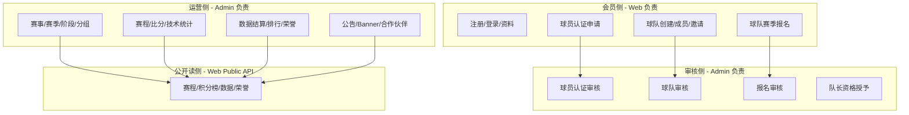

# CNPA 篮球赛事后台管理系统 — 第一批重构基线

> **批次范围**：现状盘点、业务映射、菜单权限、完整性判断、风险识别、重构方案  
> **执行日期**：2026-07-25  
> **涉及项目**：`basketball-admin`、`basketball-admin-ui`、MySQL `basketball` 库  
> **只读参考**：`basketball-web`、`basketball-web-ui`（未修改）  
> **本批次不做**：正式业务重构、目录大迁移、数据库业务数据变更

---

## 1. 执行摘要

CNPA 是线上篮球游戏赛事运营平台，由 **官网/个人中心（web + web-ui）** 与 **运营后台（admin + admin-ui）** 组成，共用同一 MySQL 库 `basketball`（当前约 **58 张 `basket_*` 表**）。

**后台现状结论：**

| 维度 | 现状 | 评估 |
|------|------|------|
| 后端业务 API | 31 个 `/basket/*` Controller，28 个 Service，44 个 Domain 实体 | 功能覆盖面广，分层不一致 |
| 前端页面 | 25 个 `views/basket/*` 页面 + 28 个 API 模块 | 与后端基本一一对应 |
| 菜单权限 | DB 已注册 **150** 条 CNPA 菜单（1 目录 + 1 二级目录 + 25 页面 + 124 按钮） | 页面级已齐全；部分按钮权限与后端不对齐 |
| 数据库 | 本地库有演示/测试数据，local-demo 标记赛事 `CNPA 本地演示联赛` | 可用于联调，注意与生产隔离 |
| Web 端分工 | 会员/球队/报名/公开读侧已在 web 实现 | Admin **不应重复开发** C 端能力 |

**重构方向（后续批次）**：统一包结构与 URL 规范、补齐权限与菜单脚本落库、抽取前端 composable、明确 Admin/Web 边界、处理 orphan 表与未挂菜单能力。

---

## 2. 系统架构基线

```text
┌─────────────────────────────────────────────────────────────────┐
│                        MySQL: basketball                         │
│                   58 × basket_* 业务表 + sys_*                  │
└───────────────┬───────────────────────────────┬─────────────────┘
                │                               │
    ┌───────────▼──────────┐         ┌──────────▼──────────┐
    │   basketball-web     │         │  basketball-admin    │
    │   (port 8881)        │         │  (port 8080)         │
    │                      │         │                      │
    │ • 会员认证/账户       │         │ • 审核（球员/球队/报名）│
    │ • 球队/邀请/加入      │         │ • 赛事结构/赛程/比分   │
    │ • 球队报名（C 端）    │         │ • 统计结算/荣誉/内容   │
    │ • Public 只读 API    │         │ • RuoYi 系统/监控      │
    └───────────┬──────────┘         └──────────┬──────────┘
                │                               │
    ┌───────────▼──────────┐         ┌──────────▼──────────┐
    │  basketball-web-ui   │         │ basketball-admin-ui  │
    │  Vue3 官网/个人中心   │         │ Vue3 + RuoYi 动态路由 │
    └──────────────────────┘         └──────────────────────┘
```

### 2.1 basketball-admin 技术栈

- Spring Boot 3.5.11 + Java 21 + MyBatis + Spring Security JWT
- 基于 RuoYi 3.9.2 单体 JAR（`com.zhs.RuoYiApplication`）
- 篮球业务集中在 `com.zhs.basket`，Controller 在 `com.zhs.web.controller.basket`（**分层不一致点**）
- 配置：`application.yml` + `application-druid.yml`（数据源 `jdbc:mysql://.../basketball`）

### 2.2 basketball-admin-ui 技术栈

- RuoYi-Vue3 + Element Plus + TypeScript
- 路由：`GET /getRouters` 动态加载，`component` 映射 `views/basket/*/index.vue`
- 权限：`v-hasPermi` + `stores/user.permissions`
- 类型：`src/types/api/basket/index.ts` 单文件 ~1630 行（**待拆分**）

---

## 3. 数据库盘点（只读）

### 3.1 表规模概览

当前库共 **58** 张 `basket_*` 表。按数据量（`TABLE_ROWS` 估算）分组：

| 分组 | 代表表 | 行数级 | Admin 管理 |
|------|--------|--------|------------|
| 会员账户 | `basket_member_account`(140), `basket_member_profile`(172) | 百级 | ❌ 无 Admin 页面（Web 自管） |
| 球员认证 | `basket_player_cert_*`(135~260), `basket_player_profile`(133) | 百级 | ✅ 审核页 |
| 球队 | `basket_team`(19), `basket_team_member`(133) | 十~百级 | ✅ 审核页（创建在 Web） |
| 赛事结构 | `basket_tournament`(4), `season`(6), `stage`(3) | 个位~十位 | ✅ 完整 |
| 比赛 | `basket_match`(31), `roster`(387), `player_stat`(259) | 十~百级 | ✅ 完整 |
| 统计排行 | `basket_player_rank`(1152), `team_rank`(160) | 百~千级 | ✅ 查询+重算 |
| 荣誉内容 | `basket_honor_record`(3), `announcement`(6), `home_banner`(4) | 个位~十位 | ✅ 完整 |
| **Orphan 表** | 见 3.2 | 0~少量 | ⚠️ 无独立 Admin 能力 |

### 3.2 无 Admin 页面/Controller 的业务表

以下表在 schema 或 Mapper 中存在，但 **无对应 Admin 菜单与 REST 管理面**：

| 表名 | 说明 | 当前引用 |
|------|------|----------|
| `basket_discipline_record` | 赛事处罚 | Admin 有 Entity/Mapper，Service 内联引用，**无管理页** |
| `basket_favorite` | 会员收藏 | 仅 Web Mapper |
| `basket_site_config` | 官网业务配置 | 仅 Web Mapper，0 行 |
| `basket_tournament_award_config` | 赛事奖项配置 | 仅 Web Mapper，0 行 |
| `basket_team_captain_history` | 队长变更记录 | 仅 Web Mapper，0 行 |
| `basket_team_season_profile` | 球队赛季档案 | LocalDemo seed/reset + Web Mapper |
| `basket_announcement_attachment` | 公告附件 | 仅 Web Mapper，0 行 |
| `basket_member_*` / `basket_verify_code_record` | 会员/验证码 | Web 专用，Admin 仅 JOIN 查询 |
| `basket_notification_setting` / `basket_privacy_setting` | 会员设置 | LocalDemo + Web |

**判断**：Orphan 表不一定是缺陷——部分属 C 端专属或预留扩展；`discipline_record`、`award_config` 若运营需要，应在后续批次评估是否补 Admin 能力。

### 3.3 本地赛事样本

| id | tournament_name | tournament_status | public_status |
|----|-----------------|-------------------|---------------|
| 992001 | 本地测试草稿赛事 | 3（关闭） | 0 |
| 992002 | 本地测试公开赛事 | 1（进行中） | 1 |
| 992014 | CNPA 本地演示联赛 | 1 | 1 |

---

## 4. 菜单与权限盘点

> 详细说明见 [`cnpa-admin-menu-permission.md`](./cnpa-admin-menu-permission.md)

### 4.1 统计

| 类型 | 数量 |
|------|------|
| CNPA 相关菜单总计 | 150 |
| 目录 (M) | 2（`CNPA赛事管理` + `荣誉与内容`） |
| 页面 (C) | 25 |
| 按钮 (F) | 124 |

### 4.2 菜单树（页面级）

**一级：CNPA赛事管理** (`menu_id=2000`, `path=basket`)

| # | 页面 | path | component | list 权限 |
|---|------|------|-----------|-----------|
| 1 | 球员认证审核 | player-certification | basket/playerCert/index | basket:playerCert:list |
| 2 | 队长资格管理 | captain-qualification | basket/captainQualification/index | basket:captainQualification:list |
| 3 | 球队审核 | team-audit | basket/teamAudit/index | basket:teamAudit:list |
| 4 | 赛事管理 | tournament | basket/tournament/index | basket:tournament:list |
| 5 | 赛季管理 | season | basket/season/index | basket:season:list |
| 6 | 赛事规则 | tournament-rule | basket/tournamentRule/index | basket:tournamentRule:list |
| 7 | 报名审核 | registration-audit | basket/registrationAudit/index | basket:registrationAudit:list |
| 8 | 赛事阶段 | stage | basket/stage/index | basket:stage:list |
| 9 | 分组管理 | group | basket/group/index | basket:group:list |
| 10 | 赛程管理 | match | basket/match/index | basket:match:list |
| 11 | 比赛名单 | match-lineup | basket/matchLineup/index | basket:lineup:list |
| 12 | 比分录入 | match-score | basket/matchScore/index | basket:score:query |
| 13 | 比赛数据 | match-stat | basket/matchStat/index | basket:matchStat:query |
| 14 | 数据结算 | data-settlement | basket/dataSettlement/index | basket:dataSettlement:list |
| 15 | 积分榜 | standing | basket/standing/index | basket:standing:list |
| 16 | 球队赛季统计 | team-season-stat | basket/teamSeasonStat/index | basket:teamSeasonStat:list |
| 17 | 球员赛季统计 | player-season-stat | basket/playerSeasonStat/index | basket:playerSeasonStat:list |
| 18 | 排行榜 | ranking | basket/ranking/index | basket:ranking:list |

**二级：荣誉与内容** (`menu_id=2101`, `path=content`)

| # | 页面 | path | list 权限 |
|---|------|------|-----------|
| 19 | 赛季名次 | season-result | basket:seasonResult:list |
| 20 | 球队荣誉 | team-honor | basket:teamHonor:list |
| 21 | 球员荣誉 | player-honor | basket:playerHonor:list |
| 22 | 名人堂 | hall-of-fame | basket:hallOfFame:list |
| 23 | 公告管理 | announcement | basket:announcement:list |
| 24 | 首页内容 | home-content | basket:homeContent:list |
| 25 | 合作伙伴 | partner | basket:partner:list |

### 4.3 角色授权

| role_id | role_name | CNPA 菜单授权 |
|---------|-----------|---------------|
| 1 | 超级管理员 | 0（若依规则：加载全部菜单） |
| 2 | 普通角色 | 151 条 |

### 4.4 权限对齐问题（已识别）

| 问题 | 菜单/前端 | 后端 | 风险 |
|------|-----------|------|------|
| 排行榜发布 | `basket:ranking:publish` (menu 2099) | **无对应 `@PreAuthorize` 与 API** | 按钮永不可见或误配 |
| 数据结算确认 | `basket:dataSettlement:confirm` (menu 2087) | **无 confirm 端点** | 同上 |
| 赛事规则查询 | 无 `basket:tournamentRule:query` 按钮 | 列表接口可能用 `list` 或未校验 | 低 |
| 判负操作 | 无独立 `basket:score:forfeit` | 复用 `basket:score:edit` | 权限粒度过粗 |
| LocalDemo | `basket:localDemoData:*` | Controller 存在，**无 sys_menu** | 仅 local profile 可用 |
| URL 命名 | 混用 camelCase / kebab-case | 同上 | 联调与文档维护成本 |

### 4.5 菜单 SQL 脚本落库状态

文档引用 `sql/cnpa-admin-menu*.sql`，但 **当前仓库 `sql/` 目录未包含这些文件**（仅 `basketball.sql`、`ry_20260321.sql`、迁移脚本）。菜单数据已在本地 DB 执行完毕，脚本需从 `basketball-admin/scripts/gen_round4_complete.py` 重新导出并纳入版本管理。

---

## 5. 页面 · 接口 · 业务表映射

### 5.1 会员与审核域

| Admin 页面 | API 前缀 | 主要 Service | 核心表 | Web 端对应 |
|------------|----------|--------------|--------|------------|
| 球员认证审核 | `/basket/playerCert` | `BasketPlayerCertService` | `basket_player_cert_application`, `_material`, `_audit`, `basket_player_profile` | `PlayerCertificationController` 提交；Admin 审核 |
| 队长资格管理 | `/basket/captainQualification` | `BasketCaptainQualificationService` | `basket_captain_qualification` | Web 查询 current；Admin 授予/撤销 |
| 球队审核 | `/basket/teamAudit` | `BasketTeamAuditService` | `basket_team`, `basket_team_audit_record`, `basket_team_member` | `AccountTeamController` 创建；Admin 审核 |

**完整性**：✅ 主链路闭环（Web 提交 → Admin 审核 → Web 可见状态）

**进行中变更**（git 工作区）：球员认证字段重构（移除 KYC/手机号相关，`migrate_player_cert_drop_kyc.sql`），Admin/Web 同步修改中。

### 5.2 赛事结构域

| Admin 页面 | API | 核心表 | Web 端 |
|------------|-----|--------|--------|
| 赛事管理 | `/basket/tournament` | `basket_tournament` | Public 只读 |
| 赛季管理 | `/basket/season`, `/basket/tournament/{id}/season` | `basket_tournament_season` | Public + 报名窗口 |
| 赛事规则 | `/basket/season/{id}/rule` | `basket_tournament_rule` | Public overview |
| 赛事阶段 | `/basket/stage` | `basket_tournament_stage` | Public standing |
| 分组管理 | `/basket/group` | `basket_tournament_group`, `_group_team` | Public group standing |

**完整性**：✅ Admin 写 + Web 读，结构完整

### 5.3 报名域

| Admin 页面 | API | 核心表 | Web 端 |
|------------|-----|--------|--------|
| 报名审核 | `/basket/registrationAudit` | `basket_tournament_registration`, `_registration_player`, `_registration_audit` | `TeamRegistrationBusinessController` 草稿/提交/撤回 |

**完整性**：✅ 球队报名主流程闭环  
**Web 缺口**：Open 个人报名、赛事内转会/自由球员等仍为 Mock（**非 Admin 职责**）

### 5.4 比赛执行域

| Admin 页面 | API | 核心表 |
|------------|-----|--------|
| 赛程管理 | `/basket/match` | `basket_match`, `basket_match_team`, `basket_venue`, `basket_match_status_log` |
| 比赛名单 | `/basket/match/{id}/lineup` | `basket_match_roster` |
| 比分录入 | `/basket/match/{id}/score` | `basket_match_period_score` |
| 比赛数据 | `/basket/match/{id}/team-stat`, `player-stat` | `basket_match_team_stat`, `basket_match_player_stat`, `basket_stat_change_record` |

**完整性**：✅ 四页联动，状态机（schedule → start → score → stat → confirm）已实现  
**Web**：`/basket/public/match/{id}` 只读展示

### 5.5 数据结算域

| Admin 页面 | API | 核心表 | Web Public |
|------------|-----|--------|--------------|
| 数据结算 | `/basket/data-settlement` | 聚合多表，写 rank/stat/standing | — |
| 积分榜 | `/basket/standing` | `basket_stage_standing` | `/basket/public/.../standing` |
| 球队/球员赛季统计 | `/basket/team-season-stat`, `player-season-stat` | `basket_team_season_stat`, `basket_player_season_stat` | `/basket/public/season/{id}/...-stat` |
| 排行榜 | `/basket/ranking` | `basket_team_rank`, `basket_player_rank` | `/basket/public/data-center/...` |
| 赛季名次 | `/basket/season-result` | 赛季结果确认 | `/basket/public/season/{id}/placement` |

**完整性**：✅ 结算链路完整；⚠️ 部分菜单权限与 API 不对齐（见 4.4）

### 5.6 荣誉与内容域

| Admin 页面 | API | 核心表 | Web Public |
|------------|-----|--------|--------------|
| 球队/球员荣誉 | `/basket/team-honor`, `player-honor` | `basket_honor_record`, `basket_honor_lineup` | team/player honor API |
| 名人堂 | `/basket/hall-of-fame` | `basket_honor_record` (source=HALL_OF_FAME) | `/basket/public/hall-of-fame/*` |
| 公告 | `/basket/announcement` | `basket_announcement` | Public announcement |
| 首页 Banner | `/basket/home-content` | `basket_home_banner` | 首页 |
| 合作伙伴 | `/basket/partner` | `basket_partner` | 首页 |

**完整性**：✅ 发布/下线/撤销流程齐全

### 5.7 无页面能力

| 能力 | API | 说明 |
|------|-----|------|
| 私有文件预览 | `GET /basket/private-file/{fileId}` | 球员认证等材料预览，/playerCert 页调用 |
| LocalDemo | `/basket/local-demo-data/*` | `@Profile(local)` + `cnpa.local-demo.enabled=true` |

---

## 6. Admin vs Web 职责边界



**不应在 Admin 重复开发的能力：**

- 会员注册、登录、资料修改
- 球队日常管理（邀请、加入、退出）
- 球队报名草稿/提交（C 端表单）
- 公开页浏览（Admin 仅运营发布源数据）

**Admin 独有、Web 不应写入的能力：**

- 比赛比分/技术统计录入与确认
- 数据结算重算
- 荣誉/名人堂/内容发布
- 三类审核的最终裁决

---

## 7. 业务完整性判断

### 7.1 核心运营链路（Admin）

| 链路 | 步骤 | 状态 |
|------|------|------|
| 球员准入 | 认证申请 → 审核 → 队长资格 → 建队 | ✅ 完整 |
| 赛事启动 | 赛事 → 赛季 → 规则 → 开放报名 | ✅ 完整 |
| 参赛 | 球队报名(Web) → 报名审核 → 分组 | ✅ 完整 |
| 竞赛 | 阶段/轮次 → 赛程 → 名单 → 比分 → 技术统计 → 结果确认 | ✅ 完整 |
| 结算 | 数据结算 → 积分榜/赛季统计/排行 → 赛季名次 → 荣誉发布 | ✅ 基本完整 |
| 内容 | 公告/Banner/合作伙伴 → 发布 → Web 展示 | ✅ 完整 |

### 7.2 部分实现 / 待产品决策

| 能力 | 状态 | 建议 |
|------|------|------|
| 赛事处罚 (`discipline_record`) | 表+枚举+Service 引用，无 Admin UI | 第二批评估是否需要处罚管理页 |
| 赛事奖项配置 (`award_config`) | 表空，无 Admin | 与赛季名次/荣誉联动设计 |
| 公告附件 | 表空，Web Mapper 存在 | 若需富文本附件再补 |
| LocalDemo 管理入口 | 无菜单 | 开发环境可通过 API 或补 dev-only 菜单 |
| Web Mock 残留 | 账户扩展、Open 报名、赛事内球队运营 | **Web 项目技术债**，Admin 重构不涉及 |

### 7.3 整体评分

| 模块 | 完整度 |
|------|--------|
| 审核三件套（球员/球队/报名） | ★★★★★ |
| 赛事结构 | ★★★★★ |
| 比赛执行 | ★★★★★ |
| 数据结算 | ★★★★☆（权限对齐扣分） |
| 荣誉内容 | ★★★★★ |
| 扩展表/处罚/奖项 | ★★☆☆☆ |

---

## 8. 风险识别

### 8.1 架构与代码风险

| ID | 等级 | 描述 | 影响 |
|----|------|------|------|
| R-B1 | **高** | Controller 在 `com.zhs.web.controller.basket`，业务在 `com.zhs.basket`，与 RuoYi 系统模块不对称 | 重构移动成本高 |
| R-B2 | **高** | Admin/Web 共用库表，无 schema 隔离；并发写入同一 `basket_match` 等表 | 状态冲突、缓存不一致 |
| R-B3 | **中** | REST URL camelCase/kebab-case 混用 | 前端 API 模块维护混乱 |
| R-B4 | **中** | `types/api/basket/index.ts` 单文件过大 | 合并冲突、类型查找困难 |
| R-B5 | **中** | 25 个页面重复「赛事→赛季→阶段」级联选择逻辑 | 改一处漏多处 |
| R-B6 | **低** | 大量页面由 `gen_round4_complete.py` 生成，手工改动易被覆盖 | 需建立生成器与手改边界 |

### 8.2 权限与菜单风险

| ID | 等级 | 描述 |
|----|------|------|
| R-P1 | **中** | 菜单 SQL 未纳入 git，环境重建困难 |
| R-P2 | **中** | `ranking:publish`、`dataSettlement:confirm` 等菜单权限无后端实现 |
| R-P3 | **低** | 非 admin 角色依赖 `sys_role_menu`；新菜单需同步授权脚本 |

### 8.3 数据与环境风险

| ID | 等级 | 描述 |
|----|------|------|
| R-D1 | **中** | LocalDemo 数据标记 `CNPA_LOCAL_DEMO_V1` / `LOCAL-DEMO-` 前缀，reset 误操作可删演示数据 |
| R-D2 | **中** | `application-local.yml` 仅在 `target/classes`，src 缺失 |
| R-D3 | **低** | 配置文件中数据库/COS 等敏感信息（见 DEF-R8-004） |

### 8.4 跨项目风险

| ID | 等级 | 描述 |
|----|------|------|
| R-X1 | **中** | 球员认证字段重构（去 KYC）进行中，Admin/Web 需同步发布 |
| R-X2 | **低** | Web 端 Mock 残留可能导致运营误判「功能已上线」 |

---

## 9. 重构方案（后续批次建议）

> 本批次仅输出方案，**不执行**下列改动。

### 9.1 批次划分建议

| 批次 | 主题 | 主要工作 |
|------|------|----------|
| **第 2 批** | 基线固化 | 导出并提交 `sql/cnpa-admin-menu*.sql`；修复权限对齐；补 `application-local.yml` 到 src |
| **第 3 批** | 结构整理 | 统一 `/basket/*` URL 为 kebab-case；Controller 迁入 `com.zhs.basket.web` 或建立 cnpa 子模块 |
| **第 4 批** | 前端治理 | 拆分 `types/api/basket/`；提取 `useTournamentCascade` composable；统一 list 页模板 |
| **第 5 批** | 边界澄清 | 文档化 Admin/Web 写权限矩阵；评估 discipline/award 是否入 Admin |
| **第 6 批** | 质量与交付 | 权限回归测试；LocalDemo 菜单（dev only）；结算链路 E2E |

### 9.2 第 2 批优先项（建议立即跟进）

1. **菜单脚本落库**：从 DB 或 `gen_round4_complete.py` 导出 `sql/cnpa-admin-menu-all.sql`，纳入版本控制  
2. **权限对齐**：删除或实现 `ranking:publish`、`dataSettlement:confirm`；为 forfeit 评估独立权限  
3. **文档同步**：更新 `cnpa-admin-menu-permission.md` 中「脚本未落库」状态  
4. **球员认证重构**：完成 Admin/Web 联调后再动下一模块  

### 9.3 明确不做的事项

- 不在 Admin 重建会员/球队 C 端功能  
- 不修改 `basketball-web` / `basketball-web-ui`（除非独立 Web 批次）  
- 不在重构初期做大规模包名/表结构变更  
- 不清理 LocalDemo 生产数据（仅 local profile）

---

## 10. 附录

### 10.1 后端 Controller 清单（31 个）

`basketball-admin/src/main/java/com/zhs/web/controller/basket/`

- 审核：`BasketPlayerCertController`, `BasketCaptainQualificationController`, `BasketTeamAuditController`, `BasketRegistrationAuditController`
- 赛事：`BasketTournamentController`, `BasketSeasonController`, `BasketTournamentRuleController`, `BasketTournamentStageController`, `BasketTournamentGroupController`, `BasketTournamentRoundController`
- 比赛：`BasketMatchScheduleController`, `BasketMatchLineupController`, `BasketMatchScoreController`, `BasketMatchStatController`
- 结算：`BasketDataSettlementController`, `BasketStandingController`, `BasketRankingController`, `BasketTeamSeasonStatController`, `BasketPlayerSeasonStatController`, `BasketSeasonResultController`
- 荣誉内容：`BasketTeamHonorController`, `BasketPlayerHonorController`, `BasketHallOfFameController`, `BasketAnnouncementController`, `BasketHomeBannerController`, `BasketPartnerController`
- 其他：`BasketPrivateFileController`, `BasketLocalDemoDataController`

### 10.2 前端 API 模块（28 个）

`basketball-admin-ui/src/api/basket/*.ts` — 与上表一一对应（含 `privateFile.ts`）。

### 10.3 相关文档

| 文档 | 用途 |
|------|------|
| [`cnpa-admin-menu-permission.md`](./cnpa-admin-menu-permission.md) | 菜单权限详解 |
| [`cnpa-local-defect-list.md`](./cnpa-local-defect-list.md) | 已知缺陷 |
| [`cnpa-web-project-architecture-audit.md`](./cnpa-web-project-architecture-audit.md) | Web 架构审计 |
| [`directory-guide.md`](./directory-guide.md) | 目录说明（部分命名过时） |

### 10.4 本批次执行记录

- [x] 阅读 `basketball-admin` / `basketball-admin-ui` 代码结构  
- [x] MySQL 只读查询（表清单、菜单树、角色授权、样本数据）  
- [x] 只读检查 `basketball-web` / `basketball-web-ui` 公共实体  
- [x] 页面·接口·表映射与完整性判断  
- [x] 风险识别与分批重构方案  
- [x] 输出本文档  

---

*文档维护：CNPA 重构第一批 · 2026-07-25*
