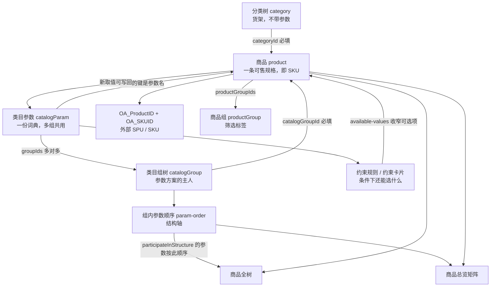

# iyge 商品配置工具：对象、关联与层层闭环

本文给后续模型（包括 ChatGPT）使用。它描述线上系统 `http://223.243.25.99:8890`（商品属性配置工具）里实际存在的对象、它们怎么连、以及配置如何从词表走到可售商品再走回矩阵。内容来自已登录后的页面路由和 `/api/v1` 实数据，不是推测出来的另一套表。

系统里没有名为 SPU 的表，也没有名为 SKU 的表。一条「商品」就是一条可售记录。对外系统用两个字段挂接：

- `oaProductId`（页面文案 `OA_ProductID`）：外部商品，业务上对应 SPU。
- `oaSkuId`（页面文案 `OA_SKUID`）：外部规格，业务上对应 SKU。

内部用来区分规格的，是类目参数的取值组合。同一款机器的公共规格前缀可以看成 SPU，把颜色、配件、网络版本等差异补全后的那一行商品就是 SKU。

---

## 1. 系统里有什么

登录后的业务菜单，和各自管的对象：

| 页面 | 路由 | 管什么 | 是否参与商品闭环 |
|---|---|---|---|
| 分类管理 | `/category` | 分类树 | 是。商品必须挂一个分类 |
| 类目管理 | `/catalog` | 类目组树，以及组内参数顺序 | 是。商品必须挂一个类目组，顺序决定树和矩阵 |
| 类目参数管理 | `/catalog-param` | 参数词典 | 是 |
| 类目参数表单 | `/catalog-param/form` | 新建/编辑一个参数 | 是 |
| 参数约束配置 | `/catalog-param/constraint` | 平铺规则：条件下可选值 | 是 |
| 参数约束（树形/链式/旧版） | `/catalog-param/constraint-tree` 等 | 同一类规则的另一种编辑器 | 是，当前这几页没有已保存的树 |
| 规则总览 | `/catalog-param/constraint-mind-map` | 把约束卡片画成思维导图 | 是 |
| 商品管理 | `/product` | 商品列表、筛选、列、视图、商品组 | 是。商品行就是 SKU |
| 商品表单 | `/product/form` | 录入一条商品 | 是 |
| 商品总览 | `/product-overview` | 按参数轴看哪些组合已经配了商品 | 是。闭环的回看面 |
| 商品全树 | `/product-tree` | 按参数顺序把已有商品铺成树 | 是。闭环的回看面 |
| 品牌管理 | `/brand` | 页面内写死的苹果/华为/小米等样例 | 否。没有品牌接口，不写入商品 |
| 用户管理 | `/user` | 登录账号 | 否 |
| 反馈管理 | `/feedback` | 问题反馈 | 否 |
| 修改密码 | `/change-password` | 当前用户密码 | 否 |

商品上的「品牌」不是品牌管理页。它是类目参数「品牌」的一个枚举值（当前有 `Apple`、`huawei`）。

---

## 2. 七个对象

### 2.1 分类 `category`

经营上的货架树。只有 `id`、`name`、`children`、`productCount`。分类不挂参数，也不指向类目组。

当前数据：

```
主机 (id=2, 商品数 2)
  手机 (id=4, 商品数 2)
  平板 (id=5, 商品数 0)
  手表 (id=6, 商品数 0)
  电脑 (id=11, 商品数 0)
配件 (id=3, 商品数 0)
  保护及保护设备 (id=12)
    保护膜 (id=13)
    保护壳 (id=14)
    test2 (id=16)
  充电类 (id=15)
```

`productCount` 是挂在这个分类上的商品数，父节点会汇总子节点。

### 2.2 类目组 `catalogGroup`

参数方案的主人。也是一棵树，字段是 `id`、`name`、`children`。类目组决定「这一种货用哪一组参数、参数按什么顺序组成结构」。

当前数据：

```
主机 (id=3)
  手机 (id=5)
    手机二 (id=16)
  平板 (id=6)
  电脑 (id=9)
  Apple Watch (id=10)
配件 (id=11)
  保护膜 (id=12)
```

分类和类目组是两棵互不指向的树，只是名字很像。对照 id 时不能按名字合并：

- 分类 `5` 是平板。
- 类目组 `5` 是手机。

现有两条商品同时挂「分类 4 手机」和「类目组 5 手机」。这两条线只在商品上相遇。

### 2.3 类目参数 `catalogParam`

规格词典。一个参数可被多个类目组共用。

| 字段 | 含义 |
|---|---|
| `id` | 参数 id。约束规则用 id，不用名字 |
| `name` | 参数名。商品 `attrs` 用名字做键 |
| `type` | 当前全部是 `enum` |
| `values` | 允许的取值 |
| `valueGroups` / `valueGroupMap` | 把取值再分成组，便于表单筛选。当前都是空的 |
| `groupIds` | 这个参数属于哪些类目组 |
| `participateInStructure` | 为 true 时，这个参数是结构轴，会占商品树的一层、总览矩阵的一行或一列 |

当前 19 个参数，全部 `participateInStructure=true`：

| id | 名称 | 已有取值 | 所属类目组 |
|---|---|---|---|
| 1 | 品牌 | Apple、huawei | 手机、平板、电脑、Apple Watch |
| 2 | 系列 | iPhone 17、iPhone 16、iPhone 15 | 同上 |
| 3 | 型号 | iPhone 17、iPhone 17 Pro、iPhone 17 Pro Max、iPhone 16 | 同上 |
| 4 | 容量 | 128G、256G、512G | 手机、平板、电脑 |
| 5 | 颜色 | 蓝色、白色、橙色 | 手机、平板、电脑、Apple Watch |
| 11 | 连接 | Wi-Fi、WLAN Cellular | Apple Watch、平板 |
| 12 | 表壳 | 铝金属表壳 | Apple Watch |
| 14 | 尺寸 | 42MM、46MM、40MM、44MM | Apple Watch |
| 15 | 表带类型 | 空 | Apple Watch |
| 16 | 表带颜色 | 空 | Apple Watch |
| 17 | 表带尺码 | 空 | Apple Watch |
| 18 | 配置 | M4 10C CPU/8C GPU/16GB/256GB FLASH | 电脑、手机、平板 |
| 19 | 内存 | 空 | 电脑、手机、平板 |
| 20 | CPU | 空 | 电脑 |
| 21 | GPU | 空 | 电脑 |
| 22 | 国家 | 空 | 手机、平板、电脑、Apple Watch |
| 23 | 类型 | 演示机 | 同上 |
| 24 | 网络版本 | A1533（电信） | 手机、平板 |
| 25 | 配件 | 简版 | 手机、平板、电脑、Apple Watch |

同一个参数挂到多个类目组后，词表是一份。在「手机」里给「颜色」新增「橙色」，「平板」里也能看到。

### 2.4 类目组内的参数顺序

顺序不属于参数自己，而属于「这个参数在这个类目组里排第几」。类目管理页拖拽后调用 `PUT /catalog-groups/{id}/param-order`，顺序体 `paramIds`。

读取某个组的有效顺序用 `GET /catalog-groups/{id}/params`。这个顺序就是结构轴顺序。

手机（类目组 5）当前顺序，从第 0 层到最后一层：

```
容量 → 品牌 → 系列 → 型号 → 配置 → 内存 → 颜色 → 配件 → 国家 → 类型 → 网络版本
```

最后一层「网络版本」在商品总览里变成列，前面每一层变成行路径。

Apple Watch（类目组 10）的顺序不同：

```
品牌 → 配件 → 系列 → 型号 → 连接 → 表壳 → 尺寸 → 颜色 → 表带类型 → 表带颜色 → 表带尺码 → 国家 → 类型
```

保护膜（类目组 12）还没有参数。没有参数就没有结构轴，也组不出 SKU 树。

### 2.5 参数约束

约束回答的是：前面已经选了这些值，下一个参数还能选哪些。它不决定树有几层，树的层数只看参数顺序。

有两套存储，当前手机类目组是连着的。

平铺规则 `param-constraints`，按「被约束的那个参数」存：

```
{
  targetParamId,
  sourceParamIds,
  rules: [
    { id, cardId, conditions: { [sourceParamId]: "值" }, options: ["允许值"] }
  ]
}
```

含义：当 `conditions` 里每个来源参数都等于指定值（并且关系）时，目标参数只能从 `options` 里选。

约束卡片 `param-constraint-cards`，按类目组存一条从左到右的链。手机类目组 5 只有一条规则卡片 `1000`，链是：

```
品牌 → 系列 → 型号 → 容量 → 颜色
```

展开后的合法路径只有这一条：

| 步骤 | 参数 | 在什么前提下 | 允许的值 | 当前示例所选 |
|---|---|---|---|---|
| 1 | 品牌 id=1 | 无 | Apple | Apple |
| 2 | 系列 id=2 | 品牌=Apple | iPhone 17、iPhone 16 | iPhone 17 |
| 3 | 型号 id=3 | 品牌=Apple 且 系列=iPhone 17 | iPhone 17、iPhone 17 Pro | iPhone 17 |
| 4 | 容量 id=4 | 上面再加 型号=iPhone 17 | 128G、256G | 128G |
| 5 | 颜色 id=5 | 上面再加 容量=128G | 蓝色、白色、橙色 | 蓝色 |

这 5 步同时被拆成 4 条平铺规则，`cardId` 都是 5，用来和卡片互指：

- 系列：来源只有品牌。Apple → iPhone 17、iPhone 16。
- 型号：来源是品牌+系列。Apple + iPhone 17 → iPhone 17、iPhone 17 Pro。
- 容量：来源是品牌+系列+型号。Apple + iPhone 17 + iPhone 17 → 128G、256G。
- 颜色：来源是品牌+系列+型号+容量。Apple + iPhone 17 + iPhone 17 + 128G → 蓝色、白色、橙色。

注意两件事实：

1. 约束链的顺序是「品牌 → 系列 → 型号 → 容量 → 颜色」。结构轴顺序是「容量 → 品牌 → 系列 → 型号 → … → 颜色 → … → 网络版本」。两套顺序各干各的。
2. 颜色这条规则只在容量=128G 时收紧。现有两条商品都是 256G，所以它们没有被这条颜色规则罩住。

另外，平铺表里还留着一批旧规则，目标参数 id 是 6、7、8、9、10，`cardId=4`。这几个参数已经不在当前 19 个参数里，取值是「苹果 / iPhone15 / iPhone 15 max」这种旧词。它们没有挂在任何一个现存类目组的规则卡片上。读约束时要认参数 id 是否还活着，不能把这批旧规则当成现在的手机链。

录入商品时，前端对当前这个参数调用：

`GET /products/available-values?catalogGroupId=&targetParamId=&selectedAttrs=`

`selectedAttrs` 是 JSON，键是已经选过的参数 id，值是选中的文本。返回：

- `availableValues`：命中规则后的可选值。
- `allValues`：这个参数的完整词典。

如果 `availableValues` 为空，表单退回完整词典，不当成「一个都不能选」。用「品牌=Apple、容量=256G」去问颜色，返回的就是空的 `availableValues` 加上完整的蓝/白/橙。因为没有任何一条规则同时覆盖这两个条件。

### 2.6 商品 `product`

这是闭环的落点。一条商品对应一个可售规格。

| 字段 | 含义 |
|---|---|
| `id` | 内部商品 id |
| `name` | 商品名称。新建时，若用户还没手改名称，会用已填的结构参数值用 `-` 拼出来 |
| `code` | 商品编码。当前两条都是空字符串 |
| `categoryId` / `categoryName` | 挂到哪条分类。表单必填 |
| `catalogGroupId` / `catalogGroupName` | 用哪套类目组参数。表单必填 |
| `status` | `on_sale` 在售，`off_sale` 停售，`draft` 草稿 |
| `oaProductId` | 外部商品 id，业务上的 SPU 指针。当前为空 |
| `oaSkuId` | 外部 SKU id。当前为 null |
| `productGroupIds` | 挂到哪些商品组。当前为空数组 |
| `attrs` | `{ 参数名: 取值 }`。只存有值的参数，没填的键不会出现 |
| `isConfigured` | true 表示这是「配置商品」，进入总览矩阵；false 表示「非配置商品」，只出现在总览下方的另一张表 |
| `isTestData` | 当前为 null |

表单上的勾选框文案是「非配置商品」。勾上后保存的是 `isConfigured=false`。

当前仅有的两条商品，都是在售、已配置：

商品 1

- 名称：Apple iPhone 17 256G 蓝色
- 分类 4 手机，类目组 5 手机
- attrs：品牌=Apple，系列=iPhone 17，型号=iPhone 17，容量=256G，颜色=蓝色
- 没有配件、网络版本、配置、内存、国家、类型

商品 2

- 名称：Apple iPhone 17 256G 白色
- 分类 4 手机，类目组 5 手机
- attrs：品牌=Apple，系列=iPhone 17，型号=iPhone 17，容量=256G，颜色=白色，配件=简版，网络版本=A1533（电信）

这两条共享同一段规格前缀（Apple / iPhone 17 / iPhone 17 / 256G）。按业务语言，这段前缀加上同一个 `oaProductId` 就是一个 SPU；每一行再带上自己的颜色和 `oaSkuId` 就是一个 SKU。现在两个 OA 字段都没填，所以和外部 iyge 商品还没有对上。

在商品表单里输入一个词典里没有的值，点「保存为预设值」，会 `POST /catalog-params/{id}/values`，把新值写回参数词典。商品录入可以反写词表。

### 2.7 商品组 `productGroup`

给商品打的另一套分组，用来在商品列表里筛选，不参与参数树，也不参与总览矩阵。当前只有一个根组「手机」(id=1)，两条商品都还没挂上去。一个商品可以挂多个商品组。删掉商品组时，会从所有商品的 `productGroupIds` 里摘掉这个 id。

---

## 3. 它们怎么连



关联时要守住这几条：

1. 分类不引用类目组，类目组不引用分类。两边只在商品上各有一个外键。
2. 参数用 `groupIds` 挂到类目组，一个参数可以挂多组。组内顺序是另一份数据。
3. 约束用参数 id。商品 attrs 用参数名。同一含义有两套键，写代码时要先做 id 与 name 的对照。
4. 结构轴只收 `participateInStructure !== false` 的参数。当前 19 个全是 true，所以手机会铺出 11 层，没填的层变成空节点，不会被跳过。
5. 总览和全树只投影已经存在的商品，不会把词典里的笛卡尔积全部展开。
6. 商品组、列配置、列表视图、品牌样例页都不改变规格结构。

---

## 4. 层层闭环

闭环不是「每张表互相外键」，而是下面六步转一圈。后一步读前一步的结果，录入时还能把新词写回词表。

### 第 1 层：先有两棵树

先建分类，回答「这件货放在哪个货架」。再建类目组，回答「这件货按哪套规格来描述」。两棵树可以长得像，但 id 独立。商品保存时两棵都要选，缺一不可。

### 第 2 层：给类目组配参数，并排好结构顺序

在类目参数里定义名称和枚举值，勾上参与结构，选所属类目组。然后在类目管理里选中某个组，拖拽参数卡片。拖完的顺序写回该组。

这一层的产出是：某个类目组拥有一条有序的结构轴。手机现在是 11 个轴，最后一个轴是网络版本。

参数可以跨组复用。手表不需要「容量」，手机不需要「表带尺码」，所以各组的轴不一样。保护膜还没有轴，因此还不能形成 SKU 结构。

### 第 3 层：用约束把词表收成合法路径

词表本身允许「huawei + iPhone 17」这种组合。约束负责说这不合法，或者只在某条前提下合法。

手机上已经闭合的一条路径是：

```
Apple
  → 系列只能是 iPhone 17 或 iPhone 16
    → 型号只能是 iPhone 17 或 iPhone 17 Pro
      → 容量只能是 128G 或 256G
        → 仅当容量是 128G 时，颜色才被收成蓝/白/橙
```

约束链和结构轴不是同一条序。结构轴把「容量」放在第 0 层，约束链把「容量」放在「颜色」前面、「型号」后面。填表时以前面已经选中的参数 id 去问 `available-values`，不要求用户按树的层序去填。

没命中规则时，可选值退回完整词典。所以 256G 的蓝手机、白手机现在能保存，并不是因为规则允许了 256G 的颜色，而是因为颜色规则没罩到 256G。

### 第 4 层：商品把一条路径落成 SKU

商品表单同时钉住：

- 分类（货架）
- 类目组（用哪套轴）
- 每个参数的一个值（规格）
- 是否配置商品
- 状态
- `OA_ProductID`、`OA_SKUID`（外部 SPU / SKU，可空）
- 商品组（可空）

名称可以由结构参数里已填的值自动用 `-` 连接。用户改过名称后不再覆盖。

一条配完的商品就是内部 SKU：`类目组 + 各结构参数的取值`。多条商品如果前面的公共参数相同，只在后面的颜色、配件、网络版本上分开，它们就是同一个 SPU 下的多个 SKU。公共身份对外应落在同一个 `oaProductId` 上，各自的 `oaSkuId` 分开。当前两条都还没填这两个字段。

勾了「非配置商品」的行不进入矩阵，只进入总览页下半部的「非配置商品」表。当前没有这种行。

### 第 5 层：全树和总览把商品读回去

这一层不新建规格，只检查第 2 层的轴和第 4 层的商品是否对得上。

商品全树按类目组的参数顺序往下长。每一层对应一个结构参数，节点名是该商品在这一层的取值。没填的参数仍占一层，名字是空字符串。叶子带 `productId`。

手机类目组上，两条商品长成：

```
256G                         容量
  Apple                      品牌
    iPhone 17                系列
      iPhone 17              型号
        (空)                 配置
          (空)               内存
            蓝色             颜色
              (空)           配件
                (空)         国家
                  (空)       类型
                    (空)     网络版本  → 商品 1
            白色
              简版           配件
                (空)
                  (空)
                    A1533（电信） → 商品 2
```

商品总览把同一条轴折成矩阵：

- 行路径：除最后一个结构参数以外的所有轴。
- 列：最后一个结构参数的取值。手机的列参数是「网络版本」，当前列值只有 `A1533（电信）`。
- 单元格：这个商品在列参数上的值是否等于该列。
- `catalogGroupPath`：类目组从根到当前组的名字，手机是 `主机 / 手机`。

因此现在的矩阵是：

| 容量 | 品牌 | 系列 | 型号 | 配置 | 内存 | 颜色 | 配件 | 国家 | 类型 | 列：A1533（电信） |
|---|---|---|---|---|---|---|---|---|---|---|
| 256G | Apple | iPhone 17 | iPhone 17 | 空 | 空 | 蓝色 | 空 | 空 | 空 | 未配置。商品 1 没有网络版本 |
| 256G | Apple | iPhone 17 | iPhone 17 | 空 | 空 | 白色 | 简版 | 空 | 空 | 已配置，商品 2 |

蓝色那条商品存在，但矩阵格子是空的。原因是列轴是网络版本，而它没填网络版本。白色那条填了 `A1533（电信）`，格子才闭合。

这就是「层层闭环」的检查点：参数顺序决定哪一个字段是列；商品 attrs 必须填到这一列，总览才会把这个 SKU 点亮。

### 第 6 层：列表、筛选、反写，把圈子转回去

商品管理按这些条件过滤：分类、类目组、名称、状态、商品组，以及「联合过滤」。联合过滤的候选项，是所选类目组里参与结构的参数和它们的词典值。过滤传给接口的 `attrs` 是 `{ 参数名: [值, ...] }`。

列表列分为两组：

- 基础列：商品名称、商品编码、分类、类目组、状态、OA_ProductID、OA_SKUID。
- 属性列：每个出现过的 `attrs` 键，按类目组归到对应列组。

列的显示和顺序存在 `column-config`，当前预设名是 `default`。列表的筛选、排序、列预设还可以存成「视图」，接口是 `product-page-config`。这两样只影响怎么看，不改变商品本身。

圈子转回去的写操作：

- 在商品表单把新词「保存为预设值」→ 参数 `values` 变长 → 下次约束选项、联合过滤、其他商品的下拉都会看到它。
- 在类目管理调整参数顺序 → 全树的层序和总览的行/列一起变。
- 改约束规则 → 下次 `available-values` 收紧或放宽，不自动改已经保存的商品。
- 删商品组 → 商品上的 `productGroupIds` 被摘掉。
- 删参数 → 应同时检查约束是否还指着这个 id。当前 id 6 到 10 的旧规则说明，参数没了之后规则可能还在。

---

## 5. 用现有数据走一遍 SPU / SKU

把两条现有商品翻译成业务语言：

SPU 侧（还没有外部 id）：

- 货架：分类「主机 / 手机」
- 规格方案：类目组「主机 / 手机」
- 公共规格：品牌 Apple，系列 iPhone 17，型号 iPhone 17，容量 256G
- 外部指针 `OA_ProductID`：空

SKU 侧：

| 内部商品 | 差异规格 | 矩阵是否点亮 | OA_SKUID |
|---|---|---|---|
| 1 蓝色 | 颜色=蓝色。配件、网络版本都空 | 否。列轴「网络版本」是空的 | 空 |
| 2 白色 | 颜色=白色，配件=简版，网络版本=A1533（电信） | 是 | 空 |

要让这个 SPU 在系统里闭合，需要：

1. 两条商品填上同一个 `OA_ProductID`。
2. 各自填上自己的 `OA_SKUID`。
3. 如果总览的列仍然是「网络版本」，蓝色那条也要有网络版本，对应格子才会变成已配置。
4. 如果 256G 的颜色也要受约束，需要把颜色规则的条件从「容量=128G」扩到 256G，或者按容量分别写规则。现在的规则不管 256G。

---

## 6. 接口对照

基础路径 `/api/v1`。除登录外都带 `Authorization: Bearer <token>`。

| 动作 | 方法与路径 |
|---|---|
| 登录 | `POST /auth/login`，体 `{username, password}` |
| 分类树 | `GET /categories`；新建 `POST /categories` `{name, parentId?}`；改名 `PUT /categories/{id}`；删除 `DELETE /categories/{id}`；移动 `PUT /categories/{id}/move` `{targetId, position}` |
| 类目组树 | `GET /catalog-groups`；新建带可选 `parentId`；改名、删除同分类 |
| 组内有序参数 | `GET /catalog-groups/{id}/params` |
| 保存组内顺序 | `PUT /catalog-groups/{id}/param-order` `{paramIds}` |
| 参数分页 | `GET /catalog-params?name=&groupIds=&page=&size=` |
| 新建/更新参数 | `POST /catalog-params`、`PUT /catalog-params/{id}`，体含 `name,type,values,valueGroups,groupIds,participateInStructure` |
| 给参数加一个值 | `POST /catalog-params/{id}/values` `{value}` |
| 商品分页 | `GET /products`，查询参数含 `categoryId,catalogGroupId,name,status,groupId,attrs,isConfigured,page,size,sortField,sortDirection,sortConfig` |
| 商品详情/保存/删除 | `GET/PUT /products/{id}`，`POST /products`，`DELETE /products/{id}` |
| 按已选条件取可选值 | `GET /products/available-values?catalogGroupId&targetParamId&selectedAttrs` |
| 总览矩阵 | `GET /products/overview?category=&catalogGroupIds=&sortConfig=` |
| 商品全树 | `GET /products/tree?catalogGroupId=` |
| 商品组 | `GET/POST /product-groups`，`PUT/DELETE /product-groups/{id}` |
| 平铺约束 | `GET /param-constraints?targetParamId=`；`POST /param-constraints`；`DELETE /param-constraints/{targetParamId}` |
| 约束树 | `GET /param-constraint-trees?catalogGroupId&targetParamId`；`GET /param-constraint-trees/by-group?catalogGroupId`；`POST /param-constraint-trees`；`DELETE /param-constraint-trees/{catalogGroupId}/{targetParamId}` |
| 规则卡片 | `GET/POST /param-constraint-cards?catalogGroupId=` |
| 列预设 | `GET/PUT /column-config?presetName=`；`GET /column-config/presets` |
| 列表视图 | `GET/PUT /product-page-config?presetName=` |

保存商品的体：

```
{
  name, code, categoryId, catalogGroupId, status,
  oaProductId, oaSkuId, productGroupIds,
  attrs: { "参数名": "取值" },
  isConfigured
}
```

---

## 7. 给后续修改的边界

后续如果要改这个系统，或让 ChatGPT 基于本文出方案，按下面的事实做，不要另起一套模型：

- 不要新增一张 SPU 表来解释现状。SPU 是同一 `oaProductId` 加上结构轴前部的公共取值；SKU 是商品行加上 `oaSkuId`。
- 分类和类目组必须继续当成两棵树。不能因为都叫「手机」就当成同一个 id。
- 商品 attrs 的键是参数名，约束的键是参数 id。
- 全树层序和总览列，以 `GET /catalog-groups/{id}/params` 的顺序为准，不以参数列表接口的返回顺序为准。
- 总览不是全排列。它只铺已经存在的商品；最后一个结构参数是列；该值为空的商品会占一行，但格子保持未配置。
- `availableValues` 为空表示「没有规则命中」，表单会退回 `allValues`，不是禁止选择。
- 品牌管理页的苹果、华为、小米、OPPO、VIVO、三星、一加是前端写死的样例，刷新不会进数据库，也不要把它和参数「品牌」连在一起设计。
- 参数 id 6、7、8、9、10 的约束是残留规则，对应的参数已经不在词典里。
- 更新商品时，前端数据层有一处把 `oaSkuId` 写成了 `oSkuId`。如果出现「编辑保存后 OA_SKUID 丢了」，先检查这条，而不是改表结构。
